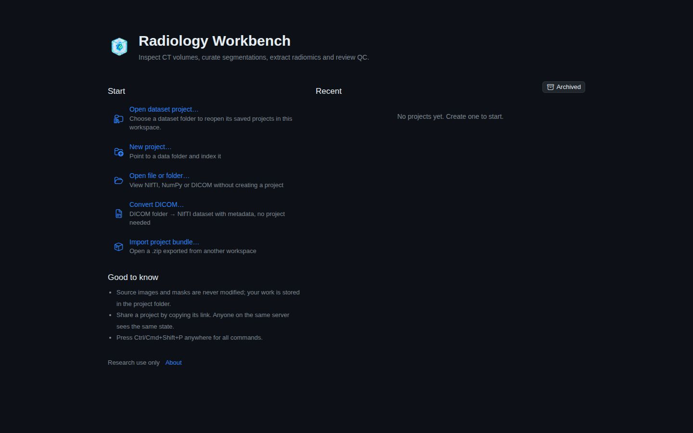
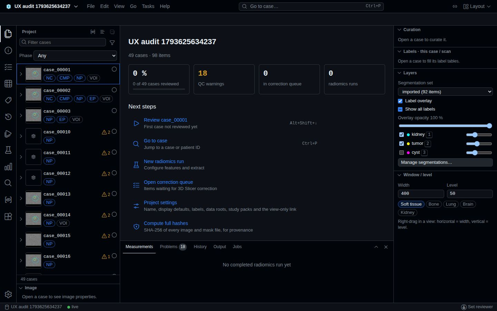
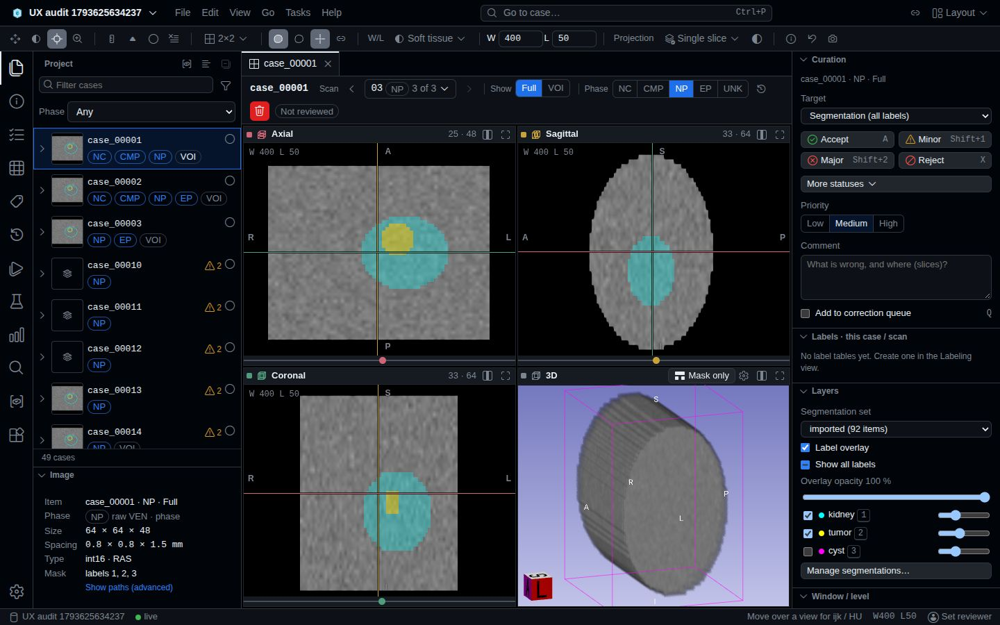

# End-to-end UX audit of the Radiology Workbench (ct_viewer), November 2026

Scope: qualitative UX and accessibility audit of the web UI on branch `version_3-dev` (commit `4f69b7c`), and incremental improvement proposals; audit only, no application code changed.
Read when: planning UX, accessibility or copy work on the frontend; deciding the next UI increments.
Depends: product/VISION.md (PRD, §Journeys G1..G4), product/SRS.md, frontend/UI_SHELL.md, frontend/ARCHITECTURE.md, ops/TESTING.md §E2E specs; requirement IDs as defined by their owners (INDEX.md §Ownership).

| Front matter | |
|---|---|
| Title | End-to-end UX audit of the Radiology Workbench (ct_viewer) |
| Date | 2026-11-02 |
| Scope | Every user journey of the PRD (G1..G4) plus the platform journeys around them (20 journeys, §I.1.2); the whole `frontend/src` UI; the E2E harness only where it affects evidence |
| Method | Heuristic evaluation (Nielsen's 10, severity 0–4), WCAG 2.2 AA conformance review (automated axe-core 4.14.0, ARIA snapshots, keyboard walks, token contrast), journey walkthroughs on the real backend with synthetic fixtures, code review of the UI by three parallel read-only agents, spot-verification of every severity ≥ 3 claim |
| Environment | Ubuntu 24.04 host (64 cores, shared, with a production DICOM conversion running); udocker container `rw-browser-verification` (Playwright 1.63, Chromium 153.0.8010.12); private backends (uvicorn, `backend/.venv`, Python 3.12) and Vite servers on ports 8137/5297, 8138/5298, 8139/5299, 8140/5300; temp workspaces in the session scratchpad; viewports 1440×900 and 1024×700; Dark and Light themes, Default and Large size |
| Evidence | 33 figures in `ux-audit-2026-11/` (JPEG reductions); 43 axe scans, 43 ARIA snapshots, 6 keyboard walks, 55 suite tests with trace + screenshot; code references `path:line` relative to `frontend/src/` unless prefixed |
| Limitations | Chromium only; no human screen-reader session; no GPU / nnU-Net run; synthetic data only (49 cases); shared, loaded host; see §I.1.6 |

## Part I — Qualitative analysis

### I.1 Context and method

#### I.1.1 Product frame

The PRD (VISION §Purpose, §Users, §Principles) defines a quiet, dense, keyboard-first workbench for three user types (curator, researcher, data engineer) with no roles (ADR-0004).
Two principles drive the evaluation: "Case, not file" (paths and internal identifiers stay hidden unless asked for) and "Quiet, dense UI … keyboard-first, progressive disclosure".
The UI contract is UI-01..UI-29 (UI_SHELL §Requirements) and FE-01..FE-11 (ARCHITECTURE §Requirements); the success metric for wayfinding is "every core object reachable in ≤ 3 actions" (VISION §Success metrics).
The audit treats these as the target state and reports where the running product departs from them, citing IDs instead of restating them (R8).

#### I.1.2 Journeys and coverage

| ID | Journey | PRD path | E2E specs (Chromium run, §I.1.5) | Audit walk | Figures |
|---|---|---|---|---|---|
| J-01 | First run: workspace home, palette, help | — | `smoke` | A01–A06, A09 | 1, 4 |
| J-02 | Open a file or folder without a project | G1 | `g1-open`, `open-mode`, `open-paging`, `open-background`, `tasks-dicom`, `ct-tools` | F01–F04 | 3, 23 |
| J-03 | Create a project and import data | G2 | `p2-flow`, `import-background`, `converter` | A07 | 2 |
| J-04 | DICOM conversion, recovery, batches | G2 | `g2-dicom`, `converter`, `converter-recovery`, `tasks-dicom`; batches: none | E01–E06 | 20–22, 27 |
| J-05 | Workbench orientation and Explorer | G3 | `p2-flow`, `g3-review` | B01–B03, B09 | 6, 31 |
| J-06 | 2×2 viewer and CT tools | G1 | `g1-open`, `ct-tools`, `viewer-fov` | C01–C03, C06 | 10 |
| J-07 | Segmentation layers and editor | G1 | `segmentation-lifecycle` | C01 (inspector) | 10 |
| J-08 | Curation review loop | G3 | `g3-review`, `tst08-multiuser` | C04–C05 | 24 |
| J-09 | Labeling tables | G3 | `labeling` | code only | — |
| J-10 | Tasks, plugins, external runner | — | `runner`, `task-selection`, `tasks-dicom` | D01–D02, H1 | 7, 15, 25 |
| J-11 | Radiomics → dashboard → analysis | G4 | `g4-radiomics` | B03 (empty state) | 9 |
| J-12 | Variables | G4 | `variables` | code only | — |
| J-13 | Jobs and Output panel | — | `projects-bundle` (Jobs only); Output: none | B04, G, H | 16–19, 32 |
| J-14 | Settings, theme, size, keybindings | — | none | B08 | 11, 12 |
| J-15 | Share link, view-only, two reviewers | G3 | `p2-flow`, `view-only`, `tst08-multiuser` | code only | — |
| J-16 | Errors, offline, reload and restore | — | `ct-tools`, `converter`, `open-mode`, `p2-flow`, `open-background`, `import-background` | A10, D03–D06, H | 5, 13, 14, 19, 28 |
| J-17 | Project lifecycle: bundle, archive, restore | — | `projects-bundle` | code only | — |
| J-18 | Plugin Library | — | none | B03 | 8 |
| J-19 | nnU-Net segmentation on a GPU | — | none (CPU fake `segment.threshold` only) | not run | — |
| J-20 | No external requests across a journey | — | `network-allowlist`, `p7c-exit` | — | — |

Not covered by any E2E spec: batch conversion (DCM-22..24 board), the Output panel (UI-29), Settings (UI-11, UI-12, UI-27), the Plugin Library (UI-22), keyboard-only operation beyond the curation keys, and offline / server-error states of the workbench.

#### I.1.3 Heuristics and criteria

- Nielsen's 10 heuristics, cited as H1 (visibility of system status), H2 (match with the real world), H3 (user control and freedom), H4 (consistency and standards), H5 (error prevention), H6 (recognition over recall), H7 (flexibility and efficiency), H8 (aesthetic and minimalist design), H9 (error recognition and recovery), H10 (help and documentation).
- Severity on Nielsen's scale: 0 not a problem · 1 cosmetic · 2 minor · 3 major · 4 catastrophe.
- WCAG 2.2 level A and AA success criteria (SC), with 2.4.13 and 2.3.3 (AAA) noted only where a project requirement asks for them (UI-16).
- Additional lenses: one term per concept (GLOSSARY), information hierarchy, recoverability (cancel / resume / undo, no dead ends) and state coverage (empty, loading, partial, error, offline, long-running, reload/restore; FE-09).

#### I.1.4 Tools, skills and agents

| Tool | Use in this audit |
|---|---|
| Playwright 1.63 (repo config extended from the scratchpad: trace on, screenshot on, Chromium only) | Full E2E suite once; four audit walks (`ux-audit`, production-build follow-up, event-stream cut, task tabs) on fresh private servers |
| axe-core 4.14.0 (installed in the scratchpad, injected at runtime; never added to the repo) | 43 WCAG 2.x A/AA scans of distinct screens |
| Playwright `ariaSnapshot` and a Tab-walk probe | Accessible names/roles per screen; focus order and focus visibility (`:focus-visible`, computed outline) |
| Token contrast script | WCAG ratios for every text/non-text token pair in `theme/tokens.css`, Dark and Light (§I.3.4) |
| Three parallel Explore agents | Code evidence by module group: shell and entry flows; execution, notifications and output; viewer, curation, labeling and dashboard |
| Skill `rw-verify` | Gate selection for each proposal (Verification lines in Part II) |
| Skill `rw-review` | Checklist applied to the proposals (rules R1–R9, layering, doc ownership, dependents) |
| Skill `code-review` | Invoked on the components most proposals touch; it reviews diffs only and found none (audit-only session), so correctness risks below come from manual verification |
| Skill `simplify` | Not invoked: it applies fixes by design; needless complexity is flagged as findings instead (F-18, F-24, F-30) |

#### I.1.5 Evidence policy and run results

- A finding needs a code reference read at that line, or a runtime artifact (figure, axe JSON, ARIA snapshot, keyboard walk, step log); "runtime" marks claims observed in the browser.
- Every severity ≥ 3 finding from an agent was re-read at the cited lines before inclusion; agent findings that could not be confirmed were dropped.
- Figures are numbered as in Appendix A. Full PNGs, traces and logs stayed in the session scratchpad and are not committed; Appendix C gives the commands to regenerate them.
- Suite run (Chromium, trace and screenshot on, servers on 8137/5297, 44.5 min): 55 tests, 38 passed, 17 failed. The 17 were re-run on a fresh server (8142/5302) without the DICOM recovery file before them: 2 passed (timing under load: `ct-tools` case errors, `g4-radiomics` RAD-01/UI-13), 15 failed again.
- Of the 15 reproducible failures, `p2-flow` asserts a tooltip string that commit `2afeaa5` ("Clean up UI copy in i18n") changed: spec drift, not a product defect.
- The other 14 reproduce on a fresh server but their cause (product regression on the branch tip, or this udocker/proot environment on a loaded host) was not established; they cluster as follows. Opening from the home does not reach `/open/{sid}` within the specs' timeouts (`g1-open`, `open-mode`, `open-paging`, `p7c-exit`, `open-background`; a separate fresh-server pass needed 9.3 s, F-71). A cancelled source operation stays `running` (`import-background`, `open-background`). The converter's "Convert N series" button does not appear after Analysis (`converter` UI-28 reload, `tasks-dicom` import wizard). Single checks: Invert stays disabled on a case tab (`ct-tools`), the `A` key on the next case records nothing (`g3-review`), an outlier row click does not open the case (`g4-radiomics` G4, DB-03), a second browser does not receive a label edit (`labeling`) or the curation item (`tst08-multiuser`), and the segmentation editor lacks the per-label Remove buttons (`segmentation-lifecycle`).
- These failures are not counted as UX findings. If a clean CI run confirms the G3/G4 ones (next-case key, outlier click, live sync), they are severity-3 defects on the PRD journeys and block REL-02.

#### I.1.6 Limitations

- Chromium only. TST-05 asks for Chromium and Firefox; Firefox was not run (time, and headless Firefox lacks WebGL2 on this host per TESTING §Verification gates).
- No human screen-reader session (NVDA, VoiceOver, Orca). Accessibility evidence is automated scans, ARIA snapshots, keyboard walks and code reading; announcements were inferred from roles and live-region attributes.
- No GPU or nnU-Net run: the production runner owns the host GPU pool, and the E2E plugin root contains only the CPU `segment.threshold` plugin. J-19 is assessed from code only (F-20).
- Synthetic fixtures only (TST-11: 49 cases, 98 items in the UI). The design envelope (500–3,000 cases, NFR §Design envelope) was not exercised, so density and virtualization findings are qualitative.
- The host was shared and loaded (load average ≈ 20, a production DICOM conversion running). Timing-sensitive spec failures are therefore classified separately (§I.1.5) and are not counted as UX findings.
- The audited tree is `4f69b7c` (the working copy was fast-forwarded from `8990d67` at 14:07, before the audit started; HEAD did not move during it).
- One harness defect surfaced during the audit (F-70): a production-build run proxied the API to the default port 8000. Nothing listens on that port on this host, so the requests failed with 502 and reached no service; the mode was not used again.

### I.2 Journey walkthroughs

Each walkthrough lists the steps, what the user sees, the friction points (finding IDs, §I.3) and the highest severity met.

**J-01 · First run (severity 2).**
Steps: open `/` → read the home → palette (`Ctrl+Shift+P`) → Keyboard shortcuts → About → New project dialog.
Sees: five equal-weight blue links under Start, an empty Recent column with a text-only hint, an Archived toggle, a "Good to know" list (Fig. 1).
Friction: three different "project" entries and an "Open" that means something else elsewhere (F-29, F-47); the empty state has no button (F-68); the home has no menu bar, so Help is reachable only through the palette or the About link; the shortcuts dialog cannot be scrolled with the keyboard and lists "View" twice (F-42, Fig. 4).
Keyboard: focus order is logical and every stop shows a 1 px focus outline (F-67).



**J-02 · Open a file without a project, G1 (severity 3).**
Steps: Home → Open file or folder… → pick a root → pick a NIfTI → viewer → Save as NIfTI… → Create project from this → Close.
Sees: a folder picker whose two roots are absolute paths cut at the end, so they look identical (F-69, Fig. 3); for a single NIfTI, a DICOM-style work window with "Recent operations", "DICOM files 0 · Series 0 · Unreadable 0" and "Cancel analysis" (F-49); then the Open-mode title row with the full host path, a green primary, and a red-bordered Close (F-30, Fig. 23).
Friction: the bar sits at 100 % with "Reading image headers 1/1" and the viewer arrives 9.3 s after Open file on a fresh server (F-71, Fig. 26); "Open folder" stays disabled without saying why (F-17); 21 Tab stops cross the action row and tool bar before the viewer (F-56); viewer loading shows a small "Loading…" with the percentage only in a tooltip (F-39).

**J-03 · Create a project and import (severity 2).**
Steps: New project… → name, dataset folder, modality → Create and import → import wizard → Explorer.
Sees: a clear dialog with help text under every field (Fig. 2); "Create and import" disabled until both fields are filled, without a reason (F-17).
Friction: no required markers, help text not linked to fields (F-36 pattern, here `NewProjectDialog.tsx:54-71`); "Dataset folder" here, "data root" and "source" elsewhere (F-47); Escape returns focus to `<body>`, not to New project… (F-41, runtime step A07).

**J-04 · DICOM conversion, recovery and batches, G2 (severity 3).**
Steps: Convert DICOM… → source → settings (Fig. 20) → Convert in batches → preview (Fig. 21) → Review batches → Start → board (Fig. 22) → minimise (Fig. 27).
Sees: a well-structured stepper (Source · Settings · Analysis · Run · Result), dry-run plans, determinate progress with ETA ranges, a minimise chip, Resume/Retry after a verified stop.
Friction: after Start the plan says "Running · 0 of 1 batches converted" while its only batch sits "Ready" until Convert this batch is pressed (F-48); Cancel conversion, Cancel analysis and Cancel plan use three verbs and only the plan asks first (F-05, F-47); four polite live regions update every 800 ms (F-22); Resume and Retry are greyed with no reason until cleanup is verified (F-17); there is no elapsed time (F-60); two buttons are named Minimize (F-61).

**J-05 · Workbench orientation and Explorer (severity 3).**
Steps: open a project → welcome tab → each of the 13 activity-bar views → panels → palette and quick open → menus.
Sees: a dense, consistent VS Code-like shell; a welcome tab with KPIs and "Next steps" (Fig. 6); the inspector showing Layers and Window/level controls even though no case is open (F-55); an empty tool-bar strip under the title bar on non-viewer tabs (F-55).
Friction: the browser tab is always titled "Radiology Workbench" (F-26); no `<main>` landmark or skip link; reaching the case filter takes 25 Tab presses and the editor tab 51, because every Explorer row's twisty is a tab stop (F-27, F-13); while cases load the footer reads "0 cases" (F-50, Fig. 28); at 1024×700 the inspector keeps 300 px and the editor shrinks to ≈ 375 px (Fig. 31).



**J-06 · 2×2 viewer and CT tools (severity 3).**
Steps: double-click a case → 2×2 → `L` cycles layouts → `F` fits → right-drag W/L → `Alt+↓` next case.
Sees: a capable Slicer-like layout with plane colours, slice indices, crosshair and a 3D view (Fig. 10).
Friction: zoom, pan, orbit, crosshair picking and measurements need a pointer drag or wheel (F-14); mouse controls other than right-drag W/L are not explained anywhere (F-53); the slice slider thumb is 10 px and the tab close target 20×20 px (F-52); the case header puts view toggles (Show Full / VOI) next to one-click phase writes (NC · CMP · NP · EP · UNK) in the same segmented style (F-32); a volume load error is a dead end (F-51).



**J-07 · Segmentation layers and editor (severity 2).**
Steps: inspector Layers → set selector, overlay, per-label visibility and opacity → Manage segmentations… → remove / restore / reimport / reindex.
Sees: a clear Layers section with `1`–`9` hints next to each label (Fig. 10).
Friction: after a label removal the hint numbers and the keys diverge (F-33); Reindex starts a project-wide job on one click; an imported set ID defaults to `reviewed` without a collision check (F-31); per-label opacity hides a 0–0.5 scale (F-62).

**J-08 · Curation review loop, G3 (severity 3).**
Steps: open a case → `A` → reviewer prompt (Fig. 24) → `Alt+↓` → `A` …
Sees: a reviewer prompt that appears just in time on the first write, a "case opened" status announcement, Accept/Minor/Major/Reject buttons with their shortcuts.
Friction: a decision is written on a single key with no undo (F-09); a comment, side or queue flag typed for one case is submitted with the next case's decision (F-08); two reviewers silently overwrite each other (F-10); the saved toast reads "Accepted · seg · …" with internal targets (F-46); queue rows open only with the mouse (F-12); the `kbd` hints on the buttons are 4.08:1 (F-44).

**J-09 · Labeling (severity 3, code only).**
The virtualised grid supports keyboard editing, paste, fill and CSV import, but the active cell is not exposed to assistive technology, sorting has no `aria-sort` (F-16), and range delete or CSV import commit at once with no undo or saved indicator (F-35).

**J-10 · Tasks, plugins and the external runner (severity 3).**
Steps: Tasks view (Fig. 7) → a task → Selection · Settings · Preflight and estimate · Runs (UI-20) → Run.
Sees: one consistent task template (Fig. 25); for the external threshold task, a red error card telling the user to start `scripts/rw-runner.py` before anything was attempted (F-20, Fig. 15).
Friction: tab titles are task IDs (`analyzer.phase`, `segment.threshold`, `dicom.convert`) and settings show raw property names (`threshold`, `seg_id`) (F-46, F-36); Run stays disabled while preflight loads, without a reason (F-17); a failure is reported four times (F-18); job kind `task` shows the raw key `jobs.kind.task` (F-07).

**J-11 · Radiomics → dashboard, G4 (severity 3).**
Sees: an empty Dashboards view with one clear primary action (Fig. 9); in a run, dockable views with consistent loading/error/empty frames.
Friction: charts are canvases with no text alternative, significance is colour-only, selection needs a brush drag (F-15); filters live in memory and are lost on reload (F-28); a failed run shows only "error" (F-19); chart animation ignores reduced motion (F-63).

**J-12 · Variables (severity 2, code only).** Derived variables and radiomics profiles are deleted on one click (F-31); segmented selectors carry both `role=radio` and `aria-pressed` (F-65).

**J-13 · Jobs and Output panel (severity 4).**
Steps: Compute full hashes → Jobs tab (Fig. 16) → Output tab (Fig. 17) → another job emits an event.
Sees: a clear Jobs table (Job · Status · Progress · ETA · Cancel), a matching status-bar item, an informative toast.
Friction: with the Activity log open, the next server event unmounts the whole application, leaving a blank page in the production build (Fig. 18) and immediately in the dev build (F-01, F-02); Cancel acts at once (F-05); when the event stream is cut the job stays "Running 156/187 · ETA 0 s" after it finished and the status bar says "connecting", never "offline" (F-03, Fig. 19); the Activity channel has no filter, copy or pause (F-24).


**J-14 · Settings, theme, size, keybindings (severity 2).**
Theme and interface size switch instantly and the Light/Large rendering holds up (Fig. 12).
Friction: reviewer, filter and recorder fields have no label; the key recorder accepts a chord that is already bound (F-37); a "Prototype › Open design reference" section is visible to every user (F-64, Fig. 11).

**J-15 · Share, view-only, two reviewers (severity 3).**
Rotate and Revoke of the view-only link act on one click, kill every shared link, and show neither feedback nor errors (F-11); dashboards are hidden from view-only users although reading writes nothing (F-54); concurrent decisions overwrite silently (F-10).

**J-16 · Errors, offline, reload (severity 3).**
Sees: good, specific cards where UI-18 is applied ("Project not found", Fig. 5; "Case not found" with Go to case… and Close tab).
Friction: with the API unreachable the title bar shows "Loading…" forever and the editor "Something went wrong · Failed to fetch" with no retry (F-06, Fig. 13); the home shows "Cannot reach the server · Failed to fetch" with no retry (F-19, Fig. 14); a 500 on the case list shows the raw server detail (F-19, Fig. 15); after a reload, W/L, the chosen set, label visibility, slice and dashboard filters are reset while the Explorer filter follows the user into another project (F-28).

**J-17 · Bundle, archive, restore (severity 1, code only).** Archive asks first and is reversible from the home's Archived list; the archive button uses the green primary style of a constructive action (F-30).

**J-18 · Plugin Library (severity 2).** Cards list every plugin with status and Open (Fig. 8); the "Adds: 2 views · 1 editor · 1 panel · 2 commands" line is developer vocabulary (F-46); every button is named just "Open" (F-46); a disabled Open gives no reason (F-17).

**J-19 · nnU-Net on a GPU (not run).** From code: queued and waiting-for-GPU runs show only a badge, a memory wait is labelled "Waiting for GPUs", and Cancel of an hours-long run is one click (F-20, F-05).

### I.3 Cross-cutting findings

#### I.3.1 Findings

Paths are relative to `frontend/src/` unless prefixed. "Fig." refers to Appendix A. Severity is Nielsen 0–4.

| ID | Finding | Heuristic / WCAG | Evidence | Sev | Journeys |
|---|---|---|---|---|---|
| F-01 | Output › Activity crashes the whole app: the effect returns `scrollIntoView()`'s value, which Chromium 153 makes a Promise; React calls it as a cleanup | H9 | `features/jobs/JobsPanel.tsx:81`; runtime: dev crash on open (Fig. 32), production crash on the next event, `#root` empty, `pageerror: l is not a function` (Fig. 18) | 4 | J-13, any with the panel open |
| F-02 | No error boundary or route `errorElement`: any render/effect error blanks the workbench with no message or reload action | H9, H3 | no `ErrorBoundary`/`componentDidCatch`/`errorElement` in `src/`; `app/App.tsx:61-67`; Fig. 18 | 3 | all |
| F-03 | Live progress freezes silently when the project event stream drops; status says "connecting", not "offline"; ETA reads "0 s" | H1 | `api/hooks.ts:104-105,699`; `app/StatusItems.tsx:25-33`; runtime H01–H04 (Fig. 19 vs 19b) | 3 | J-04, J-10, J-13 |
| F-04 | Toasts of every tone vanish after 6 s, share one polite region, never pause; a burst of four evicts an error | H1; 2.2.1, 4.1.3 | `shell/workbenchStore.ts:48-51`; `shell/Toasts.tsx:13` | 3 | J-08, J-10, J-11 |
| F-05 | Cancelling long work (GPU runs, conversions, phase analysis, radiomics, Jobs row) is one click; only a batch plan confirms | H5, H3 | `features/tasks/TaskEditor.tsx:44-48,79-83`; `plugins/dicom/ConverterOverlay.tsx:176,200`; `features/jobs/JobsPanel.tsx:62-67`; `plugins/radiomics/RadiomicsView.tsx:92`; `plugins/dicom/PhasePanel.tsx:22`; contrast `plugins/dicom/BatchBoard.tsx:184-189`; Fig. 16 | 3 | J-04, J-10, J-11, J-13, J-19 |
| F-06 | Non-404 project load errors look like loading: title "Loading…" forever, generic "Something went wrong · Failed to fetch", no retry | H1, H9 | `app/ProjectRoute.tsx:66-67`; `features/projects/ProjectSwitcher.tsx:22`; `WelcomeEditor.tsx:58-64`; Fig. 13 | 3 | J-16 |
| F-07 | Job kinds `task` and `open-convert` have no label: the raw key `jobs.kind.task` reaches the Jobs panel, status bar and Activity log | H2, H4 | `features/jobs/JobsPanel.tsx:27,52,101`; `i18n/en.json:655-661`; `backend/app/jobs/types.py:13` | 3 | J-10, J-13, J-19 |
| F-08 | The curation draft (comment, side, queue flag, target, priority) is global and only reset after a save, so it is submitted with the next case's decision | H5 | `plugins/curation/decision.ts:24-32,82`; reset only at `plugins/curation/index.ts:131` | 3 | J-08 |
| F-09 | Single-key decisions (`A`, `X`, `Shift+1/2`, `Q`) write immediately; there is no undo | H3, H5 | `plugins/curation/index.ts:86-104`; `shell/keybindings.ts:84` | 3 | J-08 |
| F-10 | Two reviewers overwrite each other silently (last writer wins; the loser only sees an "updated by" toast) | H5, H1 | `plugins/curation/decision.ts:53-89`; `plugins/curation/index.ts:24-37`; pinned by `e2e/tst08-multiuser.spec.ts` | 3 | J-08, J-15 |
| F-11 | View-only link Rotate / Revoke act on one click, break every shared link, give no feedback and drop mutation errors | H3, H5, H1 | `features/projects/settings/ProjectSettings.tsx:160-161,165`; Fig. 11 | 3 | J-15 |
| F-12 | Clickable rows are mouse-only (`<tr onClick>` without tabindex or key handler): queue, dashboard tables, analysis, radiomics failures | 2.1.1, 4.1.2 | `plugins/curation/QueueEditor.tsx:189`; `plugins/dashboard/views/common.tsx:308-320`; `views/stats.tsx:62`; `analysis/AnalysisResult.tsx:104`; `FeatureVsVolume.tsx:64`; `plugins/radiomics/RadiomicsView.tsx:41,47` | 3 | J-08, J-11 |
| F-13 | Explorer tree cursor is only `data-focused` (no `aria-activedescendant`); each row's twisty is a tab stop, 30 "Expand" stops before the editor | 4.1.2, 2.4.3 | `features/explorer/ProjectView.tsx:210-217,241-293`; `explorer.css:70`; runtime keyboard walks B02, C02 | 3 | J-05, J-06 |
| F-14 | Zoom, pan, orbit, crosshair pick and measurements need a pointer drag or wheel; no commands exist for them | 2.1.1, 2.5.7 | `features/viewer/ViewerSurface.tsx:312-367`; `features/viewer/index.ts:99-126` | 3 | J-02, J-06 |
| F-15 | Charts have no text alternative (canvas without role/label, ECharts aria off); significance and series by colour only; selection only by brush | 1.1.1, 1.3.1, 1.4.1, 2.5.7 | `plugins/dashboard/Chart.tsx:60-74,173`; `Outliers.tsx:101`; `views/stats.tsx:67`; `FeatureVsVolume.tsx:66`; `views/Scatter.tsx:39-46,82` | 3 | J-11 |
| F-16 | Labeling grid keeps focus on the container: no active-cell exposure, no `aria-sort`, `<button role=columnheader>` | 4.1.2, 1.3.1 | `plugins/labeling/TableEditor.tsx:184-196,236-243` | 3 | J-09 |
| F-17 | Primary actions are disabled without a reason: Create and import, Import and index, Open folder, Open-mode actions, Run, Resume/Retry, Library Open | H1, H9; 3.3.2 | `features/projects/NewProjectDialog.tsx:46`; `features/import/ImportWizard.tsx:259`; `features/open/OpenRoute.tsx:163-185`; `features/tasks/TaskEditor.tsx:80,320,325`; `ConverterOverlay.tsx:717-718`; `BatchBoard.tsx:68-69`; `PhasePanel.tsx:21`; `features/library/LibraryView.tsx:52`; Fig. 2, 3, 15 | 3 | J-02, J-03, J-04, J-10, J-18 |
| F-18 | One failure is reported in up to four places (toast, run row alert, Jobs row alert, Activity line) | H8; 4.1.3 | `features/tasks/index.ts:55`; `TaskEditor.tsx:77`; `JobsPanel.tsx:26-27,53` | 2 | J-10, J-13 |
| F-19 | Errors bypass `ProblemCard`: raw exception text or `error.message` with no next action (UI-18) | H9 | `TaskEditor.tsx:56,77,175`; `JobsPanel.tsx:53`; `ConverterOverlay.tsx:675,686`; `BatchBoard.tsx:82-88`; `features/variables/VariablesView.tsx:189`; `NewProjectDialog.tsx:74`; `RelinkDialog.tsx:71`; `share.tsx:46`; `ProjectView.tsx:169-173`; `WorkspaceHome.tsx:233-239`; `plugins/dashboard/DashboardEditor.tsx:168`; Fig. 14, 15 | 2 | J-03, J-04, J-10, J-11, J-16 |
| F-20 | Waiting states are mislabelled or unexplained: a memory wait reads "Waiting for GPUs"; queued and GPU waits get no help; the runner notice is a red error card with a developer command | H2, H1, H8 | `i18n/en.json:217`; `TaskEditor.tsx:64,70,261`; `PhasePanel.tsx:15`; `i18n/en.lazy.json:663,1000`; Fig. 15 | 2 | J-04, J-10, J-19 |
| F-21 | Status bar shows only the first running job, ignores queued/waiting jobs, and its lowercase connection text is neither clickable nor announced | H1; 4.1.3 | `JobsPanel.tsx:98-112`; `app/StatusItems.tsx:25-34`; Fig. 16 | 2 | J-13 |
| F-22 | Live-region noise: four polite regions in the converter change every 800 ms; the HU probe is a status region updated on every pointer move | 4.1.3 | `ConverterOverlay.tsx:143,171,190,567`; `api/hooks.ts:300`; `ViewerSurface.tsx:461` | 2 | J-04, J-06 |
| F-23 | Important async changes are not announced: connection loss, filter result counts, scan/index progress, end of volume loading | 4.1.3 | `StatusItems.tsx:25-34`; `ProjectView.tsx:332-334`; `features/explorer/SearchView.tsx:25`; `features/import/steps/DetectStep.tsx:153-158`; `IndexStep.tsx:16-17`; `ViewerSurface.tsx:390-394` | 2 | J-03, J-05, J-06 |
| F-24 | Two log views: Activity has no follow/pause, filter, copy or `role=log` and drops lines beyond 500 silently; `LogView` has no search or download, copies only filtered lines silently, re-renders 5,000 lines every second, shows no redaction marker | H4, H3, H7 | `JobsPanel.tsx:76-91`; `features/jobs/LogView.tsx:37,75-76`; `api/hooks.ts:339-354`; Fig. 17 | 2 | J-04, J-13 |
| F-25 | A failed server-log fetch shows "No output yet" forever; there is no loading or "log ended" state | H1, H9 | `features/jobs/Output.tsx:34-35` | 2 | J-13 |
| F-26 | The page title never changes ("Radiology Workbench" for every project, case and Open mode) | 2.4.2 | `index.html:6`; no `document.title` in `src/` | 2 | all |
| F-27 | No `<main>` landmark and no skip link; 25 Tab presses reach the case filter | 2.4.1 | `shell/Workbench.tsx:39-56`; runtime walk B02 | 2 | J-05, J-06 |
| F-28 | State restore is uneven: the Explorer filter is global (leaks across projects) but lost on reload; W/L, set, label visibility, slice and dashboard filters reset on reload | H6, H3 | `features/explorer/store.ts:21-33`; `state/viewerSync.ts:105-134`; `plugins/dashboard/store.ts:36-52` | 2 | J-05, J-06, J-11, J-16 |
| F-29 | The home offers five equal-weight entries with overlapping names (three lead to a project) against UI-17's three entry levels | H8, H4 | `features/projects/WorkspaceHome.tsx:173-193`; Fig. 1 | 2 | J-01 |
| F-30 | Danger styling is inconsistent: `.btn-danger` is red text only; the recycle confirm uses an undefined `btn danger` class (neutral); Open-mode Close has a red border; Archive is a green primary | H4, H5 | `theme/base.css:99-101`; `features/viewer/RecycleScan.tsx:30`; `features/open/open.css:25-26`; `features/projects/share.tsx:110`; Fig. 23 | 2 | J-02, J-06, J-17 |
| F-31 | Irreversible actions on one click: delete derived variable, delete radiomics profile, Reindex; imported set ID defaults to `reviewed` without a collision check | H5 | `VariablesView.tsx:113,166`; `plugins/radiomics/ProfileBar.tsx:53-56`; `features/viewer/SegmentationControls.tsx:22,72,123-133` | 2 | J-07, J-11, J-12 |
| F-32 | The case header renders view toggles and one-click phase writes in the same segmented style, side by side | H5, H4 | `features/viewer/CaseEditor.tsx:139`; `features/phase/PhaseButtons.tsx:37-45`; `features/viewer/ItemSwitcher.tsx:86`; Fig. 10 | 2 | J-06, J-08 |
| F-33 | Label hotkey hints come from the filtered label list while keys use the full map, so after a removal `2` toggles another label | H4, H1 | `features/viewer/Inspector.tsx:26-29,73`; `features/viewer/index.ts:155-164` | 2 | J-07 |
| F-34 | Queue table: a filter with no match says "The correction queue is empty"; CSV export ignores the filter; no sorting | H1, H4 | `plugins/curation/QueueEditor.tsx:101,106,168` | 2 | J-08 |
| F-35 | Spreadsheet range delete and CSV import commit at once, with no undo and no saved indicator | H3, H1 | `plugins/labeling/TableEditor.tsx:134-136,146-156` | 2 | J-09 |
| F-36 | Task settings form: help and errors not linked to fields, validation while typing, no required markers or units, defaults only as placeholders, raw property names | 1.3.1, 3.3.1, 3.3.2; H2 | `features/tasks/SchemaForm.tsx:10,51,58,63-66`; `features/tasks/schema.ts:41`; Fig. 15 | 2 | J-10 |
| F-37 | Settings inputs (reviewer, keybinding filter, recorder) have no label; the recorder accepts a chord already bound | 1.3.1, 3.3.2, 4.1.2; H5 | `app/Settings.tsx:38-40,76,84-97`; `state/settings.ts:26-32`; Fig. 11 | 2 | J-14 |
| F-38 | Composite ARIA misuse: listboxes of buttons, a tablist with a non-tab child, a Problems tree with a fixed `aria-expanded`, editor tabs containing a focusable close button | 1.3.1, 4.1.2 | `features/import/FolderBrowser.tsx:66,80-86`; `features/open/AddDialog.tsx:43-45`; `OpenRoute.tsx:200-202`; `shell/Panel.tsx:55-60`; `features/explorer/ProblemsPanel.tsx:44,50,54`; axe `aria-required-children` 20 screens, `nested-interactive` 9 | 2 | J-02, J-03, J-05, J-13 |
| F-39 | Progress bars have no accessible name; the indeterminate bar has no role; viewer load percentage only in a tooltip | 1.1.1, 4.1.2 | `lib/ui.tsx:96-108`; `ViewerSurface.tsx:390-394`; axe `aria-progressbar-name` 18 screens; Fig. 23 | 2 | J-02, J-04, J-06, J-13 |
| F-40 | The project switcher's accessible name ("Switch project") does not contain its visible text (the project name) | 2.5.3 | `features/projects/ProjectSwitcher.tsx:20`; axe `label-content-name-mismatch` 27 screens | 2 | J-05 and all project journeys |
| F-41 | Closing a dialog opened without a Radix trigger drops focus to `<body>` instead of the invoking button | 2.4.3 | `lib/ui.tsx:70-90`; runtime step A07 | 2 | J-03, all dialogs |
| F-42 | Keyboard shortcuts dialog: its scrolling body is not keyboard-focusable; "View" appears twice; no filter; commands named as states ("Accepted") | 2.1.1; H4 | axe `scrollable-region-focusable`; ARIA snapshot A05; Fig. 4 | 2 | J-01, J-14 |
| F-43 | The pane sash is drag-only: not focusable, no value | 2.1.1, 2.5.7 | `shell/Sash.tsx:12-28` | 2 | J-05 |
| F-44 | Contrast: `--border` is 1.36–1.68:1 on every surface while inputs share the surface colour; Light selected rows put muted/accent/status text at 3.96–4.34:1; `kbd` hints and "Waiting" badges at 3.98–4.08:1 | 1.4.3, 1.4.11 | `theme/tokens.css:119-210`; §I.3.4; axe `color-contrast` 5 screens; Fig. 12 | 2 | all |
| F-45 | Status and severity are colour plus an `aria-hidden` icon; the meaning sits only in a `title` (and is missing in quick open) | 1.1.1, 1.4.1 | `lib/badges.tsx:33-40,89-96`; `ProjectView.tsx:306-308` | 2 | J-05 |
| F-46 | Internal identifiers reach users: task IDs as tab titles and in preflight, `seg_id`/`label:N`/targets in curation, `ALLOWED_DATA_ROOTS`, regex, library names, raw converter states, plugin contribution counts, identical "Open" buttons | H2; 2.4.6 | `features/tasks/index.ts:28`; `TaskEditor.tsx:302-308`; `plugins/curation/CurationForm.tsx:123`; `History.tsx:30`; `QueueEditor.tsx:193-194`; `ConverterOverlay.tsx:346,354,551`; `features/library/LibraryView.tsx:23,33`; Fig. 8, 15, 25 | 2 | J-04, J-08, J-10, J-18 |
| F-47 | One concept, many names (job/task/run/operation; dataset/project/source/data root; segmentation/mask/label/layer/set; Problems/QC warnings; Done/Completed; five Cancel verbs; Explorer/Project; "Open" overloaded); GLOSSARY lacks Job, Dataset, Operation, Batch | H4, H2 | Appendix B; `docs/product/GLOSSARY.md` | 2 | all |
| F-48 | After Start, a batch plan reads "Running · 0 of 1 batches converted" while its batch waits as "Ready" for a second click | H1, H2 | `plugins/dicom/BatchBoard.tsx:138-145`; `en.lazy.json` `conv.batches.plan`; Fig. 22 | 2 | J-04 |
| F-49 | Opening one NIfTI shows a DICOM-oriented work window (DICOM files, Series, Unreadable counters, "Cancel analysis", full host path) | H2, H8 | `ConverterOverlay.tsx:160,575`; runtime, Fig. 26 (suite `g1-open`) | 2 | J-02 |
| F-50 | Loading misleads: the Explorer footer counts "0 cases" while loading; editors are blank without a skeleton | H1 | `features/explorer/ProjectView.tsx:333`; Fig. 28 | 2 | J-05 |
| F-51 | A volume load error shows "HTTP 404 · code" with no action; no-WebGL2 is a bare sentence | H9 | `features/viewer/ViewerSurface.tsx:380-385,436-449` | 2 | J-06 |
| F-52 | Small targets: slice-slider thumb 10 px on a 14 px track; editor-tab close 20×20 px | 2.5.8 | `features/viewer/viewer.css:220-252`; axe `target-size` 9 screens (`.etab-close`) | 2 | J-05, J-06 |
| F-53 | Viewer controls are hard to discover: Fit shows no `F`; wheel, Shift/Ctrl+wheel, middle-drag and Space-drag are documented nowhere | H6, H10 | `features/viewer/Viewport.tsx:60`; `Inspector.tsx:108`; Fig. 10 | 2 | J-06 |
| F-54 | Dashboards are hidden in view-only links (UI-26 marks them `writes`), although reading charts writes nothing | H7 | `plugins/dashboard/index.ts:44,47` | 2 | J-15 |
| F-55 | The inspector shows live Layers and W/L controls on tabs without a viewer, and an empty tool-bar strip is reserved | H8 | Fig. 6, 7, 15 | 2 | J-05, J-10 |
| F-56 | Toolbars are long tab sequences (21 stops in Open mode before the viewer) instead of one roving-tabindex toolbar | 2.4.3 (efficiency); H7 | `shell/ToolBar.tsx`; `features/viewer/CtTools.tsx`; runtime walk F02 | 2 | J-02, J-06 |
| F-57 | Editor tab pin (double-click) and close (middle-click) are mouse-only; project settings tabs lack the tab pattern | 2.1.1, 4.1.2 | `shell/EditorArea.tsx:66-71`; `ProjectSettings.tsx:415-422` | 2 | J-05, J-14 |
| F-71 | Opening one file keeps a full progress bar with "Reading image headers 1/1" for seconds before the viewer appears (9.3 s on a fresh but loaded host); when the worker is busy the window gives no queue reason | H1 | Fig. 26; runtime pass I (fresh server); suite open specs (§I.1.5) | 2 | J-02, J-16 |
| F-58 | The dialog close button is named "close" in hard-coded English; dialogs set `aria-describedby` to undefined | FE-11 | `lib/ui.tsx:75,83` | 1 | all dialogs |
| F-59 | Hard-coded English in formatters ("about 4–6 h left", "min", "s"); broken plurals and glued strings ("1 cases", "Phase: NP") | FE-11; H4 | `lib/format.ts:72-86`; `ProjectSwitcher.tsx:31`; `share.tsx:141`; `features/explorer/FilterControls.tsx:101` | 1 | J-04, J-05 |
| F-60 | Long operations show no elapsed time | H1 | `ConverterOverlay.tsx:255-256` | 1 | J-04 |
| F-61 | Two controls named "Minimize" in the converter window | 2.4.6; H8 | `ConverterOverlay.tsx:159,538` | 1 | J-04 |
| F-62 | Per-label opacity uses a hidden 0–0.5 scale and shows no value | H2 | `features/viewer/Inspector.tsx:75`; `ViewerSurface.tsx:208` | 1 | J-07 |
| F-63 | Chart animations ignore `prefers-reduced-motion` (UI-16) | 2.3.3 | `plugins/dashboard/Chart.tsx:60-74` | 1 | J-11 |
| F-64 | A "Prototype" section and an unconfirmed mock reset are visible in Settings | H8, H5 | `app/Settings.tsx:56-71`; Fig. 11 | 1 | J-14 |
| F-65 | Segmented radio groups also carry `aria-pressed` and do not move with arrow keys | 4.1.2 | `TaskEditor.tsx:274`; `plugins/radiomics/SelectionForm.tsx:71,178`; `features/variables/Dialogs.tsx:67,195`; axe `aria-allowed-attr` | 1 | J-10, J-12 |
| F-66 | Saved tabs are dropped silently when the stored layout cannot be read | H1 | `shell/EditorArea.tsx:132-136` | 1 | J-16 |
| F-67 | The focus indicator is a 1 px outline (meets 2.4.7; thin for a dense UI) | 2.4.7 | `theme/base.css:32-35`; runtime walks | 1 | all |
| F-68 | Empty states are text-only (home Recent, Explorer, Library) | H6 | `ProjectView.tsx:219-223`; `LibraryView.tsx:36`; Fig. 1 | 1 | J-01, J-05, J-18 |
| F-69 | Root paths in the folder browser are cut at the end, hiding the part that tells them apart | H6 | `features/import/FolderBrowser.tsx:80-86`; Fig. 3 | 1 | J-02, J-03 |
| F-70 | Harness: with `E2E_BUILD=1` the `VITE_API_PROXY` prefix applies only to `vite build`, so `vite preview` proxies the API to the default `127.0.0.1:8000` | H5 (developer safety) | `frontend/e2e/servers.ts:55-56,68`; `frontend/vite.config.ts` proxy default; runtime (POST 502) | 3 | test harness |

Counts: 71 findings — severity 4: 1 · 3: 17 (incl. F-70) · 2: 41 · 1: 12. F-71 was added after the table was numbered and sits with its severity group.

#### I.3.2 By Nielsen heuristic

| Heuristic | Findings | Pattern |
|---|---|---|
| H1 Visibility of system status | F-03, F-04, F-06, F-10, F-11, F-17, F-20, F-21, F-25, F-33, F-34, F-35, F-48, F-50, F-60, F-66, F-71 | Live state is trusted without a freshness signal; disabled and waiting states are silent |
| H2 Match with the real world | F-07, F-20, F-36, F-46, F-47, F-48, F-49, F-62 | Internal identifiers and enum values leak; developer instructions reach users |
| H3 User control and freedom | F-02, F-05, F-09, F-11, F-24, F-28, F-35 | Few undo paths; crashes and resets without recovery |
| H4 Consistency and standards | F-07, F-24, F-29, F-30, F-32, F-33, F-34, F-42, F-47, F-59 | Two of everything (logs, danger styles, verbs) |
| H5 Error prevention | F-05, F-08, F-09, F-10, F-11, F-30, F-31, F-32, F-37, F-64, F-70 | Destructive or data-writing actions lack friction proportional to their cost |
| H6 Recognition rather than recall | F-28, F-53, F-68, F-69 | Mouse controls and state must be remembered |
| H7 Flexibility and efficiency | F-24, F-54, F-56 | Keyboard paths exist but are long |
| H8 Aesthetic and minimalist design | F-18, F-20, F-29, F-49, F-55, F-61, F-64 | Irrelevant controls and duplicate reports add noise |
| H9 Error recognition and recovery | F-01, F-02, F-06, F-17, F-19, F-25, F-51 | UI-18 holds where `ProblemCard` is used and fails elsewhere |
| H10 Help and documentation | F-53 | Shortcuts are listed but mouse gestures are not |

#### I.3.3 By WCAG 2.2 criterion

| SC (level) | Findings | Automated evidence (axe-core, 43 scans, 8 clean) |
|---|---|---|
| 1.1.1 Non-text content (A) | F-15, F-39, F-45 | `aria-progressbar-name` 18 screens / 19 nodes |
| 1.3.1 Info and relationships (A) | F-15, F-16, F-36, F-37, F-38 | `aria-required-children` 20 screens (critical) |
| 1.4.1 Use of colour (A) | F-15, F-45 | — |
| 1.4.3 Contrast minimum (AA) | F-44 | `color-contrast` 5 screens / 8 nodes |
| 1.4.11 Non-text contrast (AA) | F-44 | token analysis §I.3.4 |
| 2.1.1 Keyboard (A) | F-12, F-14, F-42, F-43, F-57 | `scrollable-region-focusable` 1 screen |
| 2.2.1 Timing adjustable (A) | F-04 | — |
| 2.3.3 Animation from interactions (AAA, required by UI-16) | F-63 | — |
| 2.4.1 Bypass blocks (A) | F-27 | keyboard walks B02, C02 |
| 2.4.2 Page titled (A) | F-26 | — |
| 2.4.3 Focus order (A) | F-13, F-41, F-56 | keyboard walks; step A07 |
| 2.4.6 Headings and labels (AA) | F-46, F-61 | — |
| 2.4.7 Focus visible (AA) | F-67 (met) | every walked control showed `:focus-visible` |
| 2.5.3 Label in name (A) | F-40 | `label-content-name-mismatch` 27 screens |
| 2.5.7 Dragging movements (AA) | F-14, F-15, F-43 | — |
| 2.5.8 Target size minimum (AA) | F-52 | `target-size` 9 screens |
| 3.3.1 Error identification (A) | F-36 | — |
| 3.3.2 Labels or instructions (A) | F-17, F-36, F-37 | — |
| 4.1.2 Name, role, value (A) | F-12, F-13, F-16, F-37, F-38, F-39, F-57, F-65 | `nested-interactive` 9 screens; `aria-allowed-attr` 6 screens / 14 nodes |
| 4.1.3 Status messages (AA) | F-04, F-18, F-21, F-22, F-23 | — |

Met where tested: reduced motion for spinners and indeterminate bars (`theme/tokens.css:212-224`), icon-only buttons named through `IconButton`, focus visible on every walked control, modal dialogs with focus trap and Escape (Radix), toasts in a polite live region, "case opened" announced on case change (runtime C04).

#### I.3.4 Token contrast

Computed from `theme/tokens.css` (WCAG relative luminance; alpha tokens blended over `--bg-sidebar`). ✗ = below the AA threshold (4.5:1 text, 3:1 non-text).

| Pair | Dark | Light |
|---|---|---|
| `--fg` on any surface | 13.3–17.4 | 12.9–15.8 |
| `--fg-muted` on editor / sidebar / overlay | 5.07 / 5.51 / 4.64 | 5.33 / 5.01 / 5.33 |
| `--fg-muted` on `--bg-hover` | 4.20 ✗ | 4.57 |
| `--accent`, `--ok`, `--warn`, `--error`, `--done` on a selected row | 4.91–7.29 | 3.96–4.27 ✗ |
| `--fg-muted` on `--btn-secondary` (`kbd` hints, runtime) | 4.08 ✗ | — |
| `--border` on editor / sidebar / overlay (input and card boundaries) | 1.55 / 1.68 / 1.42 ✗ | 1.45 / 1.36 / 1.45 ✗ |
| `--focus` on surfaces | 3.38–4.43 | 4.45–5.19 |
| `--bg-pressed` on bars (UI-06) / on `--bg-hover` | 3.35–3.64 / 2.77 ✗ | 3.24–3.45 / 2.96 ✗ |
| White on `--btn-primary` | 4.63 | 4.52 |

`--bg-input` equals `--bg-editor` in Dark and `--bg-overlay` in Light, so the 1.4–1.7:1 border is the only cue for a text field's extent.

### I.4 Synthesis: the ten most important problems

| # | Problem | Findings | Root cause |
|---|---|---|---|
| 1 | One server event can blank the whole application, with no recovery | F-01, F-02 | Component (an effect returns a browser value) + structure (no error boundary) |
| 2 | Live progress and connection state can be stale without saying so | F-03, F-21, F-25 | State handling: views trust SSE pushes; the connection state is not propagated to the surfaces that depend on it |
| 3 | Curation can record the wrong decision silently | F-08, F-09, F-10 | State handling: a global draft, immediate commit without undo, last-writer-wins without notice |
| 4 | Notifications are transient, undifferentiated and duplicated | F-04, F-18, F-22, F-23 | Structure: one toast channel and one politeness for all severities; no routing rule per event |
| 5 | Destructive and costly actions have no consistent friction or styling | F-05, F-11, F-30, F-31, F-32 | Components: no shared destructive-action component; the danger class is undefined in one place and text-only elsewhere |
| 6 | Error states outside `ProblemCard` are dead ends | F-06, F-19, F-51 | Components: each view renders its own error text instead of the shared card with actions |
| 7 | Disabled and waiting controls do not explain themselves | F-17, F-20, F-48 | Components: the button and the command registry have no "reason" slot; status vocabulary differs per plugin |
| 8 | Composite widgets are not operable or announced as such | F-12, F-13, F-14, F-16, F-38 | Components: custom trees, grids, listboxes and canvases without the matching ARIA patterns |
| 9 | Internal identifiers and competing terms reach users | F-07, F-46, F-47, F-49 | Copy: no glossary-backed vocabulary contract; enum-driven i18n keys are not tested for coverage |
| 10 | Orientation and restore are uneven | F-26, F-27, F-28, F-29 | Structure: no route titles or landmarks; persistence decided per store, not per project |

## Part II — Improvements

### II.0 Ground rules for every proposal

- Incremental and reversible: each proposal is one small change set with its tests; no refactor of the shell, no new framework, no behaviour removed.
- Rules: R1–R9 hold; none of the proposals touches source roots, adds runtime network calls (R5, FE-06) or accounts (R2). No endpoint changes: every proposal uses existing endpoints, SSE events and stores, so `rw-api-change` is not needed.
- Frontend rules: strings only through `t()` in `i18n/en.json` / `en.lazy.json` (FE-11); colours only from `theme/tokens.css` (UI-11); codicons and the CT set (UI-15); no MUI; server data only through TanStack Query (FE-02); cross-slice calls through registry commands; shared pieces live in `src/lib` and `src/shell`.
- Docs: each behaviour change updates the one doc that owns its ID (INDEX §Ownership) in the same change; terms go to GLOSSARY.
- Gates (skill `rw-verify`): `cd frontend && npx vitest run <path>` → `npm run lint && npm run typecheck` → `make e2e-one SPEC=<name>` for UI flows → `make reqs` for docs → `make check` before done.

### II.1 Execution (jobs, runs, long tasks)

**Current state.** One task template (UI-20) with Selection · Settings · Preflight · Runs; per-run Pause, Cancel, Resume / Retry failed, Archive (`features/tasks/model.ts:13-25`); determinate progress with "About X left"; a strong converter window with stages, ETA ranges, minimise chip and verified resume (UI-28). Live state arrives by SSE only; cancellation is one click except for batch plans.
**Target pattern.** Long work is safe to start and stop (confirm cost-bearing stops), truthful while running (freshness, reasons for every waiting state, elapsed + ETA), and survivable (errors contained per region).

**P-01 · Contain crashes: fix the Activity effect and add error boundaries**
- **Claim:** Effects return only cleanup functions, and each workbench region renders inside an error boundary, so one failing panel can never blank the application.
- **Evidence:** F-01 (`features/jobs/JobsPanel.tsx:81`; Fig. 17, 18, 32), F-02.
- **Rationale:** H9, H3: a blank page with no message is a catastrophe-level dead end. Rejected: catching at `window.onerror` (React still unmounts the root) and pinning a browser version (users control their browser; Chromium 153 is current). Rejected: wrapping only the Output panel, because 14 effects use expression bodies (`rg -n "useEffect\(\(\) => [^{]" src`, e.g. `ViewerSurface.tsx:205-214,288`) and any of them can start returning a value.
- **Change:** block body at `JobsPanel.tsx:81`; review the other expression-body effects and convert those whose callee may return a value; a lint rule (`no-restricted-syntax` on `useEffect` with an expression-body arrow) in `eslint.config.js`; an `ErrorBoundary` in `src/app/` around the editor area, panel, side bar and inspector, with a fallback built from `lib/ProblemCard.tsx` (Reload panel · Reload app · Copy details) and a route `errorElement`. No behaviour removed.
- **Risk and compatibility:** specs that assert `pageerror` lists (`g1-open`, `g4-radiomics`) would no longer see contained errors, so they also assert that no fallback is visible. Owner docs: ARCHITECTURE §Requirements FE-09 (render failures contained per region).
- **Verification:** Vitest (jsdom): `ActivityLog` with `scrollIntoView` mocked to return a Promise, push lines, unmount → no throw; a throwing child renders the fallback. E2E: Output › Activity open while a hash job emits events → workbench stays mounted (new step in `projects-bundle` or a new `output-panel` spec). Acceptance: Fig. 18 cannot be reproduced; a forced panel error leaves the other regions usable.
- **Effort and priority:** S · P1 · no dependency.

**P-02 · Confirm cancellation of costly work**
- **Claim:** Cancelling a run, conversion, analysis or job asks inline what will be kept and what stops, before any request is sent.
- **Evidence:** F-05 (`TaskEditor.tsx:44-48,79-83`, `ConverterOverlay.tsx:176,200`, `JobsPanel.tsx:62-67`, `RadiomicsView.tsx:92`, `PhasePanel.tsx:22`; Fig. 16).
- **Rationale:** H5, H3: one click can discard hours of GPU work. Rejected: undo after cancel (cancellation is not reversible on the server; Resume is a new action, not an undo); rejected: a modal confirm (stacks over the converter's modal window). The inline confirm already exists twice (`BatchBoard.tsx:184-189`, `TaskEditor.tsx:326-332`).
- **Change:** extract `ConfirmInline` into `lib/ui.tsx` from those two patterns; use it at the five call sites; also offer Cancel for queued and waiting jobs in the Jobs panel; per-kind copy keys ("Cancel conversion? Converted series are kept."). No behaviour removed: the cancel requests are unchanged.
- **Risk and compatibility:** `converter-recovery`, `open-background`, `import-background` click Cancel and need one more click. Owner docs: UI_SHELL UI-20, UI-28.
- **Verification:** Vitest `ConfirmInline` (Enter confirms, Escape keeps running, focus returns); the three specs updated. Acceptance: no cancel request before confirmation.
- **Effort and priority:** M · P1 · reused by P-17.

**P-03 · Freshness signal for live state**
- **Claim:** When the project event stream is not live, every live-progress surface says "Updates paused — reconnecting", queries fall back to polling, and the status bar says "Offline" after a bounded retry.
- **Evidence:** F-03 (runtime: "Running 156/187 · ETA 0 s" after completion, Fig. 19 vs 19b), F-21, F-25.
- **Rationale:** H1: status must be true or marked as possibly stale. Rejected: always polling (server load, contradicts the SSE design); rejected: hiding progress while offline (loses information).
- **Change:** `api/connection.ts` (`useConnection`) gains a `stale` state after ~10 s of `connecting`; job and task-run queries (`api/hooks.ts:104-105,699`) set `refetchInterval` only while not live (FE-02); `Progress` gets a `stale` hint; `app/StatusItems.tsx:25-33` shows "Offline — retrying" as a button that retries. No behaviour removed.
- **Risk and compatibility:** `tst08-multiuser` live sync is unchanged while live. Owner docs: UI_SHELL UI-07.
- **Verification:** Vitest with a fake `EventSource` that errors: after 10 s the jobs query polls and the status reads Offline. E2E: the audit's H01–H04 steps as a spec (route-abort `/api/v1/projects/*/events`): the job reaches Completed while the stream is blocked. Acceptance: no surface shows Running more than 15 s after the server finished.
- **Effort and priority:** M · P1 · no dependency.

**P-04 · One waiting-state vocabulary, each state with a reason**
- **Claim:** Queued, waiting for runner, waiting for GPU, waiting for memory, cleanup and "ready, not started" share one label set and each shows a one-line reason with the next step; long operations show elapsed time next to the ETA.
- **Evidence:** F-20 (`en.json:217`, `TaskEditor.tsx:64,70,261`, `PhasePanel.tsx:15`; Fig. 15), F-48 (Fig. 22), F-60, F-71 (Fig. 26).
- **Rationale:** H1, H2. Rejected: tooltips only (not available to keyboard and touch users); rejected: per-plugin wording (the cause of today's drift).
- **Change:** extend `RunStatusBadge` / `runStatusKey` / `RUN_TONE` (`lib/badges.tsx:99-151`) with a memory-wait label and a `StateReason` line; the runner notice (`TaskEditor.tsx:261`) becomes an info card in user words with the command inside a "Details for administrators" disclosure; the batch plan chip reads "Waiting for you — Convert this batch" when the plan runs and the current batch is ready (`BatchBoard.tsx:138-145`); elapsed time at `ConverterOverlay.tsx:255-256` through the translated formatter of P-30; in the open and import work window a finished stage counter (1/1) no longer fills the bar while the next step is pending, and a queued source operation says "Waiting for a free worker". No behaviour removed.
- **Risk and compatibility:** `runner` asserts "Waiting for runner" (kept verbatim). Owner docs: UI_SHELL (Tasks view row, UI-28 batch board paragraph), DICOM docs for DCM-16 memory waits.
- **Verification:** Vitest `badges` for every status value; E2E `runner`, `converter`. Acceptance: every run, job and batch status renders a reason sentence.
- **Effort and priority:** M · P2 · after P-11.

**P-05 · Status bar job summary**
- **Claim:** The status bar summarises background work as counts (running · queued · waiting) with the connection state, announces connection changes once, and opens the Jobs panel on click.
- **Evidence:** F-21 (`JobsPanel.tsx:98-112`, `StatusItems.tsx:25-34`), F-23.
- **Rationale:** H1, 4.1.3. Rejected: listing every job in the bar (no room; UI-07 density).
- **Change:** aggregate in `JobStatusItem`; connection item as a button with a polite announcement on change only (not on progress ticks). No behaviour removed.
- **Risk and compatibility:** none known in E2E. Owner docs: UI_SHELL UI-07.
- **Verification:** Vitest for 1 running + 2 queued → "1 running · 2 queued"; one announcement per connection change.
- **Effort and priority:** S · P2 · after P-03.

### II.2 Notifications (toasts, inline, problem lists)

**Current state.** One toast store: at most four, every tone dismissed after 6 s, no pause, no de-duplication, one optional action (`shell/workbenchStore.ts:48-53`); one polite region for all tones (`shell/Toasts.tsx:13`). Inline errors use `ProblemCard` (`role=alert`) in some views and raw text in others. Failures are reported in up to four places.
**Target pattern.** Severity decides persistence and politeness; each event has one primary surface; every error is a `ProblemCard` with actions (UI-18); announcements are budgeted.

**P-06 · Severity-based toast policy**
- **Claim:** Errors and warnings stay until dismissed or resolved and are announced assertively; info and success keep the 6 s polite toast; timers pause on hover and focus; identical toasts merge with a count.
- **Evidence:** F-04 (`workbenchStore.ts:48-51`, `Toasts.tsx:13`).
- **Rationale:** WCAG 2.2.1 and 4.1.3; H1. Rejected: a longer global timeout (still fails 2.2.1 for errors and clutters for info); rejected: errors only inline (some events have no on-screen anchor, e.g. another reviewer's change, UI-10).
- **Change:** `toast({ …, key?, sticky? })` with sticky as the default for `error` and `warn`; de-duplicate by key ("×3"); never evict an error to make room for info; two containers in `Toasts.tsx` (`role=status` polite, `role=alert` for errors); Escape dismisses the focused toast. No behaviour removed.
- **Risk and compatibility:** specs that find success toasts by `getByRole('status')` (`g1-open`, `projects-bundle`, `converter`, `tst08-multiuser`) keep working; error toasts move to `role=alert`. Owner docs: UI_SHELL UI-10.
- **Verification:** Vitest store (error not auto-dismissed; merge by key) and component (roles). Acceptance: an error toast is still visible after 30 s; three identical errors show one toast "×3".
- **Effort and priority:** S · P1 · no dependency.

**P-07 · One event, one primary channel**
- **Claim:** A routing rule decides where each event is shown: inline at its object when visible, a toast only when the object is off-screen, always one Activity line.
- **Evidence:** F-18 (`features/tasks/index.ts:55`, `TaskEditor.tsx:77`, `JobsPanel.tsx:26-27,53`).
- **Rationale:** H8; 4.1.3 (one announcement per event). Rejected: removing toasts (loses off-screen awareness).
- **Change:** a `notify(event)` helper next to `toastProblem` (`shell/workbenchStore.ts:157-159`) that checks the active editor; the Jobs row shows status text instead of a second `role=alert`. No behaviour removed: every surface still shows the state.
- **Risk and compatibility:** `runner` checks row text only. Owner docs: UI_SHELL UI-10.
- **Verification:** Vitest routing table; acceptance: one alert announcement per failed run.
- **Effort and priority:** M · P2 · after P-06.

**P-08 · Every error through `ProblemCard`, with Retry**
- **Claim:** All query and mutation errors render with `ProblemCard` (plain title, cause, actions including Retry), and a project that fails to load shows a card, never an endless "Loading…".
- **Evidence:** F-06 (`app/ProjectRoute.tsx:66-67`, `ProjectSwitcher.tsx:22`; Fig. 13), F-19 (Fig. 14, 15), F-51.
- **Rationale:** UI-18 and FE-09 already require it; H9. Rejected: one global error page (loses context and the working regions).
- **Change:** `ProjectRoute.tsx` renders any `project.error` as a card with Retry (`refetch`) and Workspace home; the switcher shows "Unavailable" on error; the call sites listed in F-19 and F-51 move to `ProblemCard` / `toastProblem`; a network failure maps to "Cannot reach the server" with Retry; a new `problemAction.retry` key. No behaviour removed.
- **Risk and compatibility:** `ct-tools`, `converter`, `open-mode` assert existing card titles, which stay. Owner docs: UI_SHELL implementation notes (actions list).
- **Verification:** Vitest per view with a failing query; a new E2E `errors` spec using route-abort and a 500 (audit steps D04–D05). Acceptance: no "Loading…" after a failed load; every error card has at least one action.
- **Effort and priority:** M · P1 · no dependency.

**P-09 · Live-region budget**
- **Claim:** Screen readers hear milestones (started, stage changed, finished, failed, connection lost or restored, N results), at most one every few seconds, never per tick or per pointer move.
- **Evidence:** F-22 (`ConverterOverlay.tsx:143,171,190,567`, `ViewerSurface.tsx:461`), F-23, F-39 (end of loading).
- **Rationale:** 4.1.3. Rejected: removing the live regions (loses status messages).
- **Change:** `useAnnounce()` in `src/lib` with one shared polite region, throttled and coalescing; the converter regions become non-live with milestone announcements; the HU probe becomes non-live plus a "Read probe value" command; filter counts, import steps and "volume loaded" announce through the hook. Visible text unchanged.
- **Risk and compatibility:** specs that read the probe or converter text by `getByRole('status')` switch to text locators. Owner docs: ARCHITECTURE FE-08.
- **Verification:** Vitest throttle; ARIA snapshot diff; a manual Orca or NVDA smoke recorded in TESTING. Acceptance: under one announcement per 3 s during a conversion.
- **Effort and priority:** M · P2 · after P-06.

### II.3 Terminal / Output (log channels)

**Current state.** The Output tab has a channel select (UI-29). Server channels use `LogView` (level filter, follow with "Jump to latest", Copy, `role=log`, up to 5,000 lines refetched every second). The Activity channel is a separate component without these features, and it is the one that crashes (F-01).
**Target pattern.** One log component for every channel, virtualised, with follow/pause, level and text filters, Copy and Download, explicit loading / empty / error / ended states, and a visible redaction note.

**P-10 · One log component for every channel**
- **Claim:** Activity renders through `LogView`, and every channel shows loading, empty, error and ended states, a redaction note, search and Download.
- **Evidence:** F-24 (`JobsPanel.tsx:76-91`, `LogView.tsx:37,75-76`, `api/hooks.ts:339-354`; Fig. 17), F-25 (`Output.tsx:34-35`), F-01.
- **Rationale:** H4, H7; UI-29 asks for the same controls on every channel. Rejected: patching `ActivityLog` separately (keeps two implementations of one idea).
- **Change:** delete `ActivityLog` and feed the session lines to `LogView`; virtualise with `@tanstack/react-virtual` (already a dependency), key lines by sequence; add a text filter, "Download .log" (a local Blob, no network) and a "Copied 120 of 480 lines (filtered)" toast; `Output.tsx` shows `ProblemCard` on fetch errors and "Log ended" when the source is done; a "Host paths are redacted" note (UI-29). No behaviour removed.
- **Risk and compatibility:** no spec covers Output today (add one). Owner docs: UI_SHELL UI-29.
- **Verification:** Vitest `LogView` (filters, follow and pause, copy count), `Output` error state; new E2E `output-panel`. Acceptance: a 5,000-line channel scrolls smoothly; Activity never blanks the app.
- **Effort and priority:** M · P2 · after P-01.

**P-11 · A label for every enum value, enforced by the compiler**
- **Claim:** Each enum-driven label (job kinds, run, conversion, plan and batch statuses) comes from an exhaustive `Record<Enum, key>` map, so a new backend value fails typecheck instead of showing a raw key.
- **Evidence:** F-07 (`JobsPanel.tsx:27,52,101`, `en.json:655-661`, `backend/app/jobs/types.py:13`), F-46 (raw converter states, `ConverterOverlay.tsx:346,354,551`).
- **Rationale:** H2, FE-11. Rejected: `defaultValue` fallbacks to the enum (hides the gap; users read `task`).
- **Change:** add `jobs.kind.task` and `jobs.kind.open-convert` and the missing `conv.status.*` keys; typed maps next to the components that use them (types from the generated schema, which is not edited). No behaviour removed.
- **Risk and compatibility:** none. Owner docs: none (FE-11 already applies).
- **Verification:** `npm run typecheck`; `npx vitest run src/i18n`. Acceptance: the Jobs panel shows a label for a task run (assert in `runner`).
- **Effort and priority:** S · P1 · no dependency.

### II.4 Location and navigation

**Current state.** The URL encodes project, case, item and layout (FE-04); tabs and layout persist per project (UI-13); the activity bar marks the current view; quick open and the palette work on every route (UI-05). The browser title never changes, there is no `main` landmark, the Explorer filter is global, viewer display state is not restored, and the home lists five equal entries.
**Target pattern.** "Where am I" is answered by the tab title, the page title and landmarks; per-project state survives a reload; the home mirrors UI-17's three levels; loading and context are honest.

**P-12 · Route-aware page title**
- **Claim:** `document.title` names the location, e.g. "case_00042 · NP — Dataset820 — Radiology Workbench" or "Settings — Dataset820".
- **Evidence:** F-26.
- **Rationale:** 2.4.2; two reviewers or an Open session in other tabs become distinguishable. Rejected: a static title per route (does not name the case). In Open mode the title stays "Open — Radiology Workbench" without the file or folder name, because source paths may carry patient names (NFR-17).
- **Change:** a `useDocumentTitle` hook in `src/app/` fed by the active editor's title and the project name. No behaviour removed.
- **Risk and compatibility:** none. Owner docs: UI_SHELL implementation notes.
- **Verification:** Vitest; `toHaveTitle` in `g1-open` and `p2-flow`. Acceptance: one title per route as listed.
- **Effort and priority:** S · P2 · no dependency.

**P-13 · Landmarks, skip link and region cycling**
- **Claim:** The editor area is the `main` landmark, a "Skip to editor" link is the first Tab stop, and `F6` cycles title bar, side bar, editor, panel and inspector.
- **Evidence:** F-27 (25 Tab presses to the filter, 51 to the editor tab; walks B02, C02).
- **Rationale:** 2.4.1. Rejected: `F6` alone (not discoverable; keep both).
- **Change:** `shell/Workbench.tsx:39-56` wraps the editor area in `<main>`; a visually hidden skip link styled with tokens; a registry command bound to `F6`. No behaviour removed.
- **Risk and compatibility:** region locators in specs are unaffected. Owner docs: UI_SHELL UI-01, default keybindings table; ARCHITECTURE FE-08.
- **Verification:** axe `landmark-one-main` and `region` pass; keyboard walk reaches the editor in ≤ 2 Tab presses.
- **Effort and priority:** S · P2 · no dependency.

**P-14 · Per-project state that survives a reload**
- **Claim:** The Explorer filter and expansion are kept per project, viewer display state per item (W/L, set, label visibility, slice), dashboard filters per run, and a lost saved layout is reported instead of dropped silently.
- **Evidence:** F-28 (`features/explorer/store.ts:21-33`, `state/viewerSync.ts:105-134`, `plugins/dashboard/store.ts:36-52`), F-66 (`EditorArea.tsx:132-136`).
- **Rationale:** H6, H3; it extends UI-13's per-project persistence. Rejected: putting all of it in the URL (long links; share links would carry one person's view state).
- **Change:** key the Explorer store by project and persist it like `state/layout.ts`; persist the display slice per item with an LRU cap; persist dashboard filters per run; an info toast when saved tabs cannot be restored. "Reset view" (`R`) still resets. No behaviour removed.
- **Risk and compatibility:** first open keeps the CT default W/L (VW-05); storage capped. Owner docs: UI_SHELL UI-13, ARCHITECTURE FE-04, VIEWER (display state).
- **Verification:** Vitest persistence; E2E reload in `viewer-fov` keeps W/L. Acceptance: reload restores the listed state; another project starts unfiltered.
- **Effort and priority:** M · P3 · no dependency.

**P-15 · A home that follows UI-17's three levels**
- **Claim:** The home groups its entries under "View files" (Open file or folder…, Convert DICOM…) and "Projects" (New project…, Reopen from a dataset folder…, Import bundle…), with one primary action on first run and an empty Recent that offers buttons.
- **Evidence:** F-29 (`features/projects/WorkspaceHome.tsx:173-193`; Fig. 1), F-68.
- **Rationale:** H8, H4; UI-17. Rejected: removing entries (behaviour loss); rejected: a first-run wizard (slows experts).
- **Change:** regroup with headings, keep every entry, primary style for New project… only when no project exists, copy from P-30. No entry removed.
- **Risk and compatibility:** specs click these buttons by name (`g1-open`, `converter`, `open-mode`, `p2-flow`, `projects-bundle`): keep accessible names or update the specs. Owner docs: UI_SHELL UI-04, UI-17.
- **Verification:** E2E `smoke` and the specs above. Acceptance: exactly one primary action on an empty workspace.
- **Effort and priority:** M · P3 · after P-30.

**P-16 · Honest loading and context-aware chrome**
- **Claim:** Loading lists say "Loading…" without a count, editors keep their layout with a skeleton, and inspector sections that need a viewer collapse to a one-line hint on other tabs; an empty tool bar takes no height.
- **Evidence:** F-50 (`ProjectView.tsx:333`; Fig. 28), F-55 (Fig. 6, 7, 15).
- **Rationale:** H1, H8. Rejected: hiding the inspector when no case is open (UI-13: it starts visible and explicit choices are respected).
- **Change:** show the count only once data has loaded; Layers and Window/level render a hint like the Curation section already does; collapse the empty `shell/ToolBar.tsx` row (UI-06 already wants it empty). No behaviour removed.
- **Risk and compatibility:** `segmentation-lifecycle` uses the inspector on a case tab (unchanged). Owner docs: UI_SHELL UI-06, UI-13.
- **Verification:** Vitest; visual check of Fig. 6 and 28 equivalents. Acceptance: no "0 cases" while loading.
- **Effort and priority:** S · P3 · no dependency.

### II.5 Buttons and actions

**Current state.** `.btn` (secondary), `.btn-primary` (green), `.btn-danger` (red text only) in `theme/base.css:85-101`; consistent dialog footers (Cancel left, primary right); inline confirms in two places; Archive confirmed and reversible; many destructive or data-writing actions on one click; disabled buttons rarely explain themselves.
**Target pattern.** Friction proportional to cost: confirm what cannot be undone, offer Undo for what can, style danger one way, separate writes from view toggles, and explain every disabled action.

**P-17 · A destructive-action contract**
- **Claim:** One filled danger style used only for destructive confirmations, a confirmation step for irreversible actions, and an Undo toast for reversible ones.
- **Evidence:** F-11 (`ProjectSettings.tsx:160-161,165`), F-30 (`base.css:99-101`, `RecycleScan.tsx:30`, `open.css:25-26`, `share.tsx:110`), F-31.
- **Rationale:** H5, H4. Rejected: confirming everything (confirmation fatigue; reversible actions deserve Undo).
- **Change:** new tokens `--btn-danger` and `--btn-danger-fg` (≥ 4.5:1) in both themes and a filled `.btn-danger`; `RecycleScan.tsx:30` uses `btn btn-danger`; Open-mode Close returns to a neutral style; Rotate / Revoke get `ConfirmInline` (P-02), a success toast and a `ProblemCard` on error; derived-variable and profile deletes and Reindex confirm with one sentence of consequence; the imported set ID is checked against loaded sets. No behaviour removed.
- **Risk and compatibility:** `theme/tokens.test.ts` (tokens only); specs `view-only`, `segmentation-lifecycle`, `variables`, `projects-bundle` add one click. Owner docs: UI_SHELL Theme tokens table (UI-11), §Commands (Archive row).
- **Verification:** token test; Vitest confirm flows; the four specs; axe contrast on the danger button.
- **Effort and priority:** M · P1 · after P-02.

**P-18 · Safe curation: item-scoped draft and Undo**
- **Claim:** The curation draft belongs to the item it was typed for, and every decision toast offers Undo for a few seconds by appending the previous status as a new event.
- **Evidence:** F-08 (`plugins/curation/decision.ts:24-32,82`), F-09 (`plugins/curation/index.ts:86-104`).
- **Rationale:** H5, H3; the append-only store (CUR-14) makes a compensating event auditable. Rejected: a confirm per key (destroys G3's "next case without the mouse"); rejected: delayed commit (risks losing decisions; NFR-14).
- **Change:** drafts keyed by item in `decision.ts`; returning to an item restores its draft; the toast action slot (already used at `plugins/curation/index.ts:31`) carries Undo, which posts through the existing curation events endpoint. No API change; keys still write immediately.
- **Risk and compatibility:** History shows the undo as an event (intended); `g3-review` must not lose focus to the toast. Owner docs: CURATION (CUR-*), UI_SHELL default keybindings note.
- **Verification:** Vitest draft isolation across item changes; `g3-review` extended: comment typed on case A, `Alt+↓`, `A` on case B → B's event has no comment; Undo restores the previous status.
- **Effort and priority:** M · P1 · no dependency.

**P-19 · Notice before overwriting another reviewer's decision**
- **Claim:** If someone else decided this item after the case was opened, the inspector shows "Dr. AP set Rejected 12 s ago" with Keep mine / Use theirs before writing.
- **Evidence:** F-10 (`decision.ts:53-89`, `plugins/curation/index.ts:24-37`).
- **Rationale:** H5, H1. Rejected: server-side locks (contradict the live multi-user model and need an API change). The client already receives the events by SSE.
- **Change:** track the latest event per item with reviewer and time; compare before submitting; inline banner with two actions. Server behaviour (last writer wins) unchanged.
- **Risk and compatibility:** `tst08-multiuser` adds one click for the second writer. Owner docs: CURATION.
- **Verification:** Vitest; `tst08-multiuser` extended. Acceptance: the second reviewer sees the banner before overwriting.
- **Effort and priority:** M · P2 · after P-18.

**P-20 · Separate data writes from view toggles in the case header**
- **Claim:** The phase control in the case header looks and reads as a write ("Set phase" with chips) and its toast offers Undo, while Show Full / VOI stays a view toggle.
- **Evidence:** F-32 (`features/viewer/CaseEditor.tsx:139`, `features/phase/PhaseButtons.tsx:37-45`, `ItemSwitcher.tsx:86`; Fig. 10).
- **Rationale:** H5, H4. Rejected: moving phase to the inspector only (G3 asks for one-click phase in reach).
- **Change:** use the `PhaseChip` variant with a "Set phase" label in the header; reuse the P-18 Undo toast. No behaviour removed.
- **Risk and compatibility:** `g2-dicom`, `g3-review` use the phase buttons by name (kept). Owner docs: PHASE (PHS-*), UI_SHELL.
- **Verification:** the two specs. Acceptance: no `.seg` group in the header performs a write.
- **Effort and priority:** S · P2 · after P-18.

**P-21 · Every disabled action says why**
- **Claim:** Buttons and registry commands accept a `disabledReason`, shown as tooltip, as the button's accessible description and in the palette, which lists disabled commands dimmed instead of hiding them.
- **Evidence:** F-17 (call sites in §I.3.1; Fig. 2, 3, 15); palette hides disabled commands (`shell/CommandPalette.tsx:36`).
- **Rationale:** H1, H9, 3.3.2; precedent `features/import/steps/PatternByExample.tsx:113`. Rejected: never disabling and validating on click (fine for forms, wrong for state-gated actions such as Resume during cleanup).
- **Change:** a reason slot in `lib/ui.tsx` (button and `IconButton`), `disabledReason?: () => string | undefined` on commands in `shell/registry.ts`, applied at the F-17 call sites. No behaviour removed.
- **Risk and compatibility:** `registry.test.ts`, palette tests. Owner docs: UI_SHELL UI-05 and §Commands.
- **Verification:** Vitest; `task-selection` asserts the reason before a selection exists. Acceptance: every disabled control in the F-17 files has a non-empty accessible description.
- **Effort and priority:** M · P1 · no dependency.

### II.6 Lists, tables and filters

**Current state.** The Explorer is virtualised and filterable with removable chips (VAR-10); dashboards use a shared `ViewFrame` with loading, error and empty states; the labeling grid is virtualised with keyboard editing. Rows that open things are mouse-only; the tree cursor is not exposed; the queue's empty state and export ignore the filter.
**Target pattern.** WAI-ARIA APG patterns for tree, grid and listbox; one Tab stop per composite; Enter opens, Shift+F10 opens the item menu; filter-aware empty states and exports.

**P-22 · Keyboard-operable rows**
- **Claim:** Every row that opens something is reachable (roving tabindex, one stop per table), opens on Enter and offers its item menu on Shift+F10.
- **Evidence:** F-12 (six call sites in §I.3.1).
- **Rationale:** 2.1.1, 4.1.2. Rejected: an extra "Open" button per row (doubles Tab stops, hurts density).
- **Change:** `rowProps` (`plugins/dashboard/views/common.tsx:308-320`) adds tabindex, key handling and a name; `useItemMenu` opens on Shift+F10; reuse at the other call sites. No behaviour removed.
- **Risk and compatibility:** `g4-radiomics` click path unchanged. Owner docs: DASHBOARD (DB-*).
- **Verification:** Vitest `rowProps`; a keyboard variant in `g4-radiomics` (Tab into the outliers table, Enter opens the case).
- **Effort and priority:** S · P1 · no dependency.

**P-23 · APG patterns for the Explorer tree and other composites**
- **Claim:** The Explorer tree is one Tab stop with `aria-activedescendant`; folder pickers are listboxes of options; the panel tablist holds only tabs; the Problems tree reports real expansion; editor tabs contain no focusable children; status badges carry text for assistive technology.
- **Evidence:** F-13, F-38, F-45, F-57 (axe `aria-required-children` 20 screens, `nested-interactive` 9), F-69 (Fig. 3).
- **Rationale:** 4.1.2, 1.3.1, 2.4.3; FE-08 already asks for it. Rejected: a third-party tree or grid library (bundle growth, NFR-07; styling drift from UI-11).
- **Change:** `ProjectView.tsx:210-217,241-293` (row ids, `aria-activedescendant`, twisties `tabIndex=-1`, restore the container focus ring at `explorer.css:70`); `FolderBrowser.tsx:66,80-86`, `AddDialog.tsx:43-45`, `OpenRoute.tsx:200-202` (`role=option`, root paths shortened in the middle with `midEllipsis` from `lib/format.ts`); `shell/Panel.tsx:55-60`; `ProblemsPanel.tsx:44,50,54`; tab close buttons `tabIndex=-1` (close with `Alt+W`, pin with a command); visually hidden status text in `lib/badges.tsx:33-40,89-96`. No behaviour removed.
- **Risk and compatibility:** specs select folders as `getByRole('listbox', { name: 'Folders' }).getByRole('button', …)` (`g1-open`, `converter`, `converter-recovery`, `open-mode`, `open-background`, `import-background`, `p2-flow`); they move to `option`. Ship in its own increment. Owner docs: ARCHITECTURE FE-08; UI_SHELL UI-08.
- **Verification:** axe rules above at zero on the audit screens; keyboard walk reaches the editor tab within 3 stops from the tree; the specs updated.
- **Effort and priority:** L · P2 · after P-36 (to lock the gains).

**P-24 · Labeling grid: announced cells, sorting state, undo**
- **Claim:** The grid exposes the active cell, sortable headers report `aria-sort`, a "Saving… / Saved" state is visible, and Ctrl+Z reverts the last bulk edit through compensating cell events.
- **Evidence:** F-16, F-35 (`plugins/labeling/TableEditor.tsx:134-136,146-156,184-196,236-243`).
- **Rationale:** 4.1.2, H3, H1. Rejected: confirming every paste (slows the main use).
- **Change:** roving focus on grid cells; header buttons inside `columnheader` cells; reuse the cell history already kept for each cell. No behaviour removed.
- **Risk and compatibility:** `labeling` two-browser sync. Owner docs: LABELING (LBL-*).
- **Verification:** Vitest; `labeling` adds Ctrl+Z after a range delete; axe on the grid.
- **Effort and priority:** L · P3 · no dependency.

**P-25 · Queue table: filter-aware empty state and export, sorting**
- **Claim:** The correction queue distinguishes "no items match this filter" from "the queue is empty", exports what is shown (with Export all kept), and sorts by column.
- **Evidence:** F-34 (`plugins/curation/QueueEditor.tsx:101,106,168`).
- **Rationale:** H1, H4. Rejected: the status quo of a silent full export.
- **Change:** two empty-state strings, an "Export shown" action next to "Export all", sortable headers with `aria-sort`. No behaviour removed.
- **Risk and compatibility:** `tst08-multiuser` reads the queue CSV through the existing export (kept). Owner docs: CURATION.
- **Verification:** Vitest; `tst08-multiuser`.
- **Effort and priority:** S · P3 · no dependency.

### II.7 Forms and settings

**Current state.** Dialog forms use `htmlFor` labels and help text; the import alias field shows the model pattern (`aria-invalid` + `aria-describedby`, `steps/RootStep.tsx:60-63`); project settings handle ETag conflicts with Reapply / Discard (UI-23). The schema form validates while typing and shows raw property names; Settings inputs have no labels.
**Target pattern.** Every field has a programmatic label, description and error; validation on blur and submit; required and units visible; defaults shown as values; human titles.

**P-26 · An accessible schema form**
- **Claim:** Schema fields link label, help and error, validate on blur and submit, mark required fields, show units and defaults as text, and use titles instead of property names; segmented choices behave as radio groups.
- **Evidence:** F-36 (`features/tasks/SchemaForm.tsx:10,51,58,63-66`, `schema.ts:41`; Fig. 15), F-65.
- **Rationale:** 1.3.1, 3.3.1, 3.3.2, H2; precedent `RootStep.tsx:60-63`. Rejected: per-plugin custom forms (breaks UI-20's single template).
- **Change:** field ids with `aria-describedby` and `aria-invalid`; a humanised fallback when a manifest has no title; drop `aria-pressed` from `role=radio` buttons and add arrow keys (`TaskEditor.tsx:274`, `plugins/radiomics/SelectionForm.tsx:71,178`, `features/variables/Dialogs.tsx:67,195`). No behaviour removed.
- **Risk and compatibility:** `runner`, `task-selection` fill fields by label (kept or improved). Owner docs: TASKS (schema form), UI_SHELL UI-20.
- **Verification:** Vitest `SchemaForm`; axe on a task tab (`aria-allowed-attr` at zero).
- **Effort and priority:** M · P2 · no dependency.

**P-27 · Settings: labels, key conflicts, no prototype section**
- **Claim:** Settings fields get visible labels; the key recorder warns about conflicts (Replace / Cancel) and can bind commands without a default; the Prototype section is hidden from users (Help › Open design reference remains).
- **Evidence:** F-37 (`app/Settings.tsx:38-40,76,84-97`, `state/settings.ts:26-32`), F-64 (`app/Settings.tsx:56-71`; Fig. 11).
- **Rationale:** 1.3.1, 3.3.2, H5, H8. Rejected: dropping key rebinding (UI-12 requires it).
- **Change:** labels; conflict check with `bindingOf`; confirm the mock reset; hide the section outside development builds. No behaviour removed.
- **Risk and compatibility:** no spec covers Settings: add `settings` (theme, size, rebinding with a conflict). Owner docs: UI_SHELL UI-12.
- **Verification:** Vitest; new E2E `settings`.
- **Effort and priority:** S · P3 · no dependency.

### II.8 Dialogs, panels and overlays

**Current state.** One Radix-based `Dialog` (`lib/ui.tsx:56-90`) with scrim, focus trap, Escape and ×; global keys pause while a dialog is open; the converter is a modal work window that minimises to a chip (UI-25, UI-28); the 3D options panel is a good non-modal pattern. Focus is not returned after closing; panes resize by drag only.
**Target pattern.** Focus always returns to the invoker; dialogs are fully keyboard-operable; panes and toolbars follow APG separator and toolbar patterns.

**P-28 · Focus return, a usable shortcuts dialog, translated controls**
- **Claim:** Closing any dialog returns focus to its invoker; the shortcuts dialog is keyboard-scrollable, filterable and grouped once per category with action names; the close button is translated; the two "Minimize" controls get distinct names.
- **Evidence:** F-41 (runtime A07), F-42 (`app/HelpDialogs.tsx`; Fig. 4), F-58 (`lib/ui.tsx:75,83`), F-61 (`ConverterOverlay.tsx:159,538`).
- **Rationale:** 2.4.3, 2.1.1, 2.4.6, FE-11. Rejected: a custom focus manager (Radix `onCloseAutoFocus` suffices when given the invoker).
- **Change:** `Dialog` stores `document.activeElement` when it opens and restores it in `onCloseAutoFocus`; `aria-label={t('common.close')}`; an optional description id instead of `aria-describedby={undefined}`; in `HelpDialogs.tsx` a focusable body region, merged groups and a filter reused from the Settings keybinding filter; command titles as actions ("Mark accepted") while statuses stay "Accepted". No behaviour removed.
- **Risk and compatibility:** `converter-recovery.spec.ts:208` uses `.first()` on Minimize (update). Owner docs: UI_SHELL default keybindings.
- **Verification:** Vitest focus return; axe `scrollable-region-focusable` at zero; `p2-flow` asserts focus back on New project… after Escape.
- **Effort and priority:** S · P2 · no dependency.

**P-29 · Keyboard-resizable panes and one-stop toolbars**
- **Claim:** Sashes are focusable separators with a value (arrows resize, Enter resets), and the viewer tool bar and Open-mode action row are toolbars with one Tab stop and arrow-key movement.
- **Evidence:** F-43 (`shell/Sash.tsx:12-28`), F-56 (walk F02: 21 stops).
- **Rationale:** 2.1.1, 2.5.7, 2.4.3. Rejected: pane-size commands only (not discoverable).
- **Change:** `role=separator` with `aria-valuenow/min/max` in `Sash.tsx` (one fix covers side bar, panel and inspector); roving tabindex in `shell/ToolBar.tsx`, `features/viewer/CtTools.tsx`, `ItemSwitcher.tsx`. Tool shortcuts (`M`, `W`, `C`, `Z`) unchanged.
- **Risk and compatibility:** role-based locators unchanged. Owner docs: UI_SHELL UI-06, UI-13.
- **Verification:** Vitest `Sash` keys; keyboard walk reaches the viewer within 8 stops in Open mode.
- **Effort and priority:** M · P3 · no dependency.

### II.9 Copy and vocabulary

**Current state.** Almost every string goes through `t()`; the copy is short and mostly plain. The same concept carries several names across plugins (Appendix B), internal identifiers leak (F-46), and a few formatters and plurals bypass i18n (F-59). GLOSSARY defines Task, Run and Workspace task but not Job, Dataset, Operation or Batch.
**Target pattern.** One term per concept owned by GLOSSARY; names instead of IDs everywhere, with IDs in tooltips and Copy actions (UI-08 generalised); numbers, plurals and durations through i18next and `Intl` (FE-11).

**P-30 · A vocabulary contract**
- **Claim:** Adopt the terms of Appendix B, record them in GLOSSARY (adding Job → "background work", Dataset, Batch; retiring "operation" from the UI), and change the English strings, not the keys, area by area.
- **Evidence:** F-47 (Appendix B), F-59 (`lib/format.ts:72-86`, `ProjectSwitcher.tsx:31`, `share.tsx:141`, `FilterControls.tsx:101`).
- **Rationale:** H4, H2; R8 makes GLOSSARY the single owner of terms. Rejected: renaming keys as well (code and test churn with no user benefit).
- **Change:** GLOSSARY rows; `en.json` / `en.lazy.json` values; i18next plurals; duration and ETA formatting through `t()` and `Intl`. No behaviour removed.
- **Risk and compatibility:** E2E specs assert visible strings ("Completed", "Waiting for runner", "Import finished", button names); rename one area per change and update its specs in the same change. Owner docs: GLOSSARY; UI_SHELL where strings are quoted.
- **Verification:** `npx vitest run src/i18n`; the area's specs (`make e2e-one SPEC=…`). Acceptance: Appendix B terms only in the UI.
- **Effort and priority:** M · P2 · no dependency.

**P-31 · Names, not identifiers**
- **Claim:** Tabs and suggestions use task titles, curation and queue use set and label names, plugin cards say what the user gets, and a single NIfTI opens without DICOM counters; raw IDs stay in tooltips and Copy actions.
- **Evidence:** F-46 (`features/tasks/index.ts:28`, `TaskEditor.tsx:302-308`, `CurationForm.tsx:123`, `History.tsx:30`, `QueueEditor.tsx:193-194`, `LibraryView.tsx:23,33`; Fig. 8, 15, 25), F-49 (Fig. 26), F-07.
- **Rationale:** H2; UI-08 and UI-18; PRD principle "Case, not file". Rejected: hiding IDs entirely (power users copy them).
- **Change:** task tab title from the manifest title; preflight suggestions by title; curation strings with set and label names; plugin "Adds: …" moved into a details disclosure and buttons named "Open" plus the plugin name; for non-DICOM sources the open window hides DICOM counters and says "Cancel opening"; admin details (environment variable names, regexes, library names) behind "Details". No behaviour removed.
- **Risk and compatibility:** specs that read tab names; `runner` uses the heading (unchanged). Owner docs: UI_SHELL UI-08 (generalised), UI-22.
- **Verification:** Vitest; an E2E text scan that fails on a visible `word.word` task ID outside tooltips.
- **Effort and priority:** M · P2 · after P-11, P-30.

### II.10 Accessibility baseline

**Current state.** Focus is visible on every walked control (1 px `--focus` outline); reduced motion is honoured for spinners; icon-only buttons are named; dialogs trap focus; toasts are live. Gaps: pointer-only viewer operations, inaccessible charts, low-contrast boundaries, unnamed progress bars, a label-in-name mismatch on every project screen, and no automated regression check.
**Target pattern.** Keyboard parity for every viewer operation; data views with a table alternative; token pairs that pass by construction; an axe gate in E2E.

**P-32 · Keyboard parity in the viewer**
- **Claim:** Every pointer-only viewer operation gets a command with a default key (zoom in/out, pan, slice step, crosshair to centre, 3D orbit), the mouse map is documented in a viewer help popover and the shortcuts dialog, and small targets grow to 24 px.
- **Evidence:** F-14 (`ViewerSurface.tsx:312-367`, `features/viewer/index.ts:99-126`), F-33 (`Inspector.tsx:26-29,73` vs `features/viewer/index.ts:155-164`), F-52 (`viewer.css:220-252`; axe `target-size`), F-53 (`Viewport.tsx:60`, `Inspector.tsx:108`), F-62 (`Inspector.tsx:75`).
- **Rationale:** 2.1.1, 2.5.7, 2.5.8, H6, H10. Rejected: relying on the W/L number inputs (they cover W/L only).
- **Change:** register commands with `when: 'viewer'`; reach NiiVue only through the engine handle (VIEWER rule); chords avoid the curation and label keys of UI_SHELL §Default keybindings; Fit and other tooltips show their chord (`formatChord(bindingOf(cmd))`, as in `Tools.tsx:20`); a 16 px thumb with a 24 px hit area; per-label opacity as 0–100 % with `aria-valuetext`; the `1`–`9` hints and the label keys read the same filtered label list. No behaviour removed.
- **Risk and compatibility:** keybinding conflicts (checked with P-27's detector). Owner docs: VIEWER (VW-*), UI_SHELL keybindings table.
- **Verification:** Vitest registration; a keyboard variant of `viewer-fov` (zoom one view by keys, Fit restores). Acceptance: every mouse operation in VIEWER has a key.
- **Effort and priority:** M · P2 · after P-27 (conflict check).

**P-33 · Accessible charts**
- **Claim:** Every dashboard view offers "Show as table", ECharts descriptions, non-colour encodings, a keyboard alternative to brushing and no animation under reduced motion.
- **Evidence:** F-15 (`plugins/dashboard/Chart.tsx:60-74,173`, `Outliers.tsx:101`, `views/stats.tsx:67`, `FeatureVsVolume.tsx:66`, `views/Scatter.tsx:39-46,82`), F-63.
- **Rationale:** 1.1.1, 1.3.1, 1.4.1, 2.5.7, UI-16. Rejected: CSV download as the only alternative (status quo; it leaves the app).
- **Change:** a table toggle in `ViewFrame` (`views/common.tsx:71`), rows per P-22; ECharts `aria` on and `animation` off under reduced motion; `StatusBadge` text for significance; series symbols; selection by row checkboxes. No behaviour removed. F-54 (dashboards in view-only links) goes to the UI-26 owner as a decision, not a change.
- **Risk and compatibility:** the dashboard chunk is lazy (FE-05), so NFR-07 is unaffected. Owner docs: DASHBOARD (DB-*), UI_SHELL UI-16.
- **Verification:** Vitest `ViewFrame` toggle; `g4-radiomics` via the table path; axe.
- **Effort and priority:** M · P2 · after P-22.

**P-34 · Contrast by construction**
- **Claim:** A `--border-control` token (≥ 3:1 on every surface) bounds inputs, selects and secondary buttons, and the Light selected-row and `kbd` pairs reach 4.5:1, checked by the token unit test.
- **Evidence:** F-44 (§I.3.4; axe `color-contrast` 5 screens), F-67.
- **Rationale:** 1.4.11, 1.4.3, 2.4.7. Rejected: darkening `--border` globally (every divider gets heavy; changes the identity of ADR-0023).
- **Change:** new token in both themes in `theme/tokens.css`; `base.css` controls use it; adjusted Light `--bg-selected` and the `kbd` foreground; a pure-function contrast assertion in `theme/tokens.test.ts`; optionally a 2 px focus ring. No behaviour removed.
- **Risk and compatibility:** visual change on every screen; the viewer harness compares viewports only. Owner docs: UI_SHELL Theme tokens table (UI-11).
- **Verification:** token test; axe `color-contrast` at zero on the audit screens. Acceptance: every ✗ in §I.3.4 turns into a pass.
- **Effort and priority:** S · P2 · no dependency.

**P-35 · Names for progress bars and the project switcher**
- **Claim:** Every progress bar has a name ("Full hash, 86 of 187"), the indeterminate bar is a progressbar without a value inside an `aria-busy` region, and the switcher's name contains the project name.
- **Evidence:** F-39 (`lib/ui.tsx:96-108`; axe 18 screens), F-40 (`ProjectSwitcher.tsx:20`; axe 27 screens).
- **Rationale:** 1.1.1, 4.1.2, 2.5.3. Rejected: hiding the bars from assistive technology (removes status).
- **Change:** `Progress({ label })` as a required prop so typecheck finds every call site; `aria-label={t('projects.switchNamed', { name })}`. No behaviour removed.
- **Risk and compatibility:** specs that locate "Switch project" by name use a regex. Owner docs: ARCHITECTURE FE-08.
- **Verification:** typecheck; axe `aria-progressbar-name` and `label-content-name-mismatch` at zero.
- **Effort and priority:** S · P1 · no dependency.

**P-36 · An automated accessibility gate**
- **Claim:** A dedicated E2E spec scans the key screens with axe and walks Tab order for landmarks and focus visibility, with an allow-list that may only shrink.
- **Evidence:** §I.3.3 (35 of 43 scans with violations); F-38, F-39, F-40, F-44, F-52.
- **Rationale:** prevents regressions that unit tests cannot see. Rejected: periodic manual audits only.
- **Change:** devDependency `@axe-core/playwright` (test-only and local, so R5, FE-06 and NFR-07 hold); `e2e/a11y.spec.ts`; a TESTING §E2E specs row and a new TST row in TESTING. No product behaviour change.
- **Risk and compatibility:** a new dependency needs approval; adds 1–2 minutes per browser.
- **Verification:** `make e2e-one SPEC=a11y` in both browsers. Acceptance: no critical or serious violation outside the allow-list.
- **Effort and priority:** M · P2 · best after P-35.

### II.11 Test harness (outside the module list)

**P-37 · Pin the preview proxy in production-build E2E runs**
- **Claim:** With `E2E_BUILD=1`, `vite preview` receives `VITE_PORT` and `VITE_API_PROXY`, and the harness refuses the lane ports, so a build run can never reach a developer's server on 8000.
- **Evidence:** F-70 (`frontend/e2e/servers.ts:55-56,68`; runtime 502 during this audit).
- **Rationale:** H5 for developers; tests must never touch real servers or data. Rejected: changing the Vite default target (the dev lane relies on it).
- **Change:** apply the environment to both commands of the BUILD chain (or set `env` on the Playwright `webServer` entry) and throw if `API_PORT` is 8000. No behaviour change for dev runs.
- **Risk and compatibility:** none. Owner docs: TESTING §E2E specs (`E2E_BUILD`).
- **Verification:** `E2E_BUILD=1 make e2e-one SPEC=smoke` on private ports with a tripwire listener on 8000. Acceptance: no connection to 8000.
- **Effort and priority:** S · P1 · no dependency.

### II.12 Roadmap

Each increment is independently shippable, keeps every behaviour, and ends with `make check` plus the listed specs.

| Increment | P-xx | Module | Priority | Effort | Depends on | Docs to update |
|---|---|---|---|---|---|---|
| 1 · Stop the bleeding | P-01 | Execution | P1 | S | — | ARCHITECTURE (FE-09) |
| 1 | P-11 | Terminal / Output | P1 | S | — | — |
| 1 | P-37 | Test harness | P1 | S | — | TESTING §E2E specs |
| 1 | P-35 | Accessibility | P1 | S | — | ARCHITECTURE (FE-08) |
| 1 | P-06 | Notifications | P1 | S | — | UI_SHELL (UI-10) |
| 2 · Safe actions | P-02 | Execution | P1 | M | — | UI_SHELL (UI-20, UI-28) |
| 2 | P-17 | Buttons and actions | P1 | M | P-02 | UI_SHELL (UI-11 tokens, §Commands) |
| 2 | P-18 | Buttons and actions | P1 | M | — | CURATION; UI_SHELL keybindings |
| 2 | P-21 | Buttons and actions | P1 | M | — | UI_SHELL (UI-05, §Commands) |
| 3 · Truthful state | P-03 | Execution | P1 | M | — | UI_SHELL (UI-07) |
| 3 | P-08 | Notifications | P1 | M | — | UI_SHELL implementation notes |
| 3 | P-05 | Execution | P2 | S | P-03 | UI_SHELL (UI-07) |
| 3 | P-04 | Execution | P2 | M | P-11 | UI_SHELL (Tasks view, UI-28); DICOM docs |
| 4 · Keyboard structure | P-22 | Lists and tables | P1 | S | — | DASHBOARD |
| 4 | P-13 | Location / navigation | P2 | S | — | UI_SHELL (UI-01, keybindings); ARCHITECTURE (FE-08) |
| 4 | P-12 | Location / navigation | P2 | S | — | UI_SHELL implementation notes |
| 4 | P-28 | Dialogs and overlays | P2 | S | — | UI_SHELL keybindings |
| 4 | P-34 | Accessibility | P2 | S | — | UI_SHELL (UI-11 tokens table) |
| 4 | P-36 | Accessibility | P2 | M | P-35 | TESTING (E2E row, new TST row) |
| 5 · Announcements and logs | P-07 | Notifications | P2 | M | P-06 | UI_SHELL (UI-10) |
| 5 | P-09 | Notifications | P2 | M | P-06 | ARCHITECTURE (FE-08); TESTING (manual SR smoke) |
| 5 | P-10 | Terminal / Output | P2 | M | P-01 | UI_SHELL (UI-29) |
| 6 · Words | P-30 | Copy and vocabulary | P2 | M | — | GLOSSARY; UI_SHELL quoted strings |
| 6 | P-31 | Copy and vocabulary | P2 | M | P-11, P-30 | UI_SHELL (UI-08, UI-22) |
| 6 | P-20 | Buttons and actions | P2 | S | P-18 | PHASE; UI_SHELL |
| 6 | P-19 | Buttons and actions | P2 | M | P-18 | CURATION |
| 6 | P-26 | Forms and settings | P2 | M | — | TASKS; UI_SHELL (UI-20) |
| 7 · Composite widgets and viewer | P-23 | Lists and tables | P2 | L | P-36 | ARCHITECTURE (FE-08); UI_SHELL (UI-08) |
| 7 | P-27 | Forms and settings | P3 | S | — | UI_SHELL (UI-12) |
| 7 | P-32 | Accessibility | P2 | M | P-27 | VIEWER; UI_SHELL keybindings |
| 7 | P-33 | Accessibility | P2 | M | P-22 | DASHBOARD; UI_SHELL (UI-16) |
| 8 · Persistence and polish | P-14 | Location / navigation | P3 | M | — | UI_SHELL (UI-13); ARCHITECTURE (FE-04); VIEWER |
| 8 | P-15 | Location / navigation | P3 | M | P-30 | UI_SHELL (UI-04, UI-17) |
| 8 | P-16 | Location / navigation | P3 | S | — | UI_SHELL (UI-06, UI-13) |
| 8 | P-29 | Dialogs and overlays | P3 | M | — | UI_SHELL (UI-06, UI-13) |
| 8 | P-25 | Lists and tables | P3 | S | — | CURATION |
| 8 | P-24 | Lists and tables | P3 | L | — | LABELING |

P-27 ships in increment 7 because P-32 needs its key-conflict check.

Counts: 37 proposals — P1: 12 · P2: 18 · P3: 7; effort S: 15 · M: 20 · L: 2.

## Appendix A — Figures

All in `ux-audit-2026-11/` (1440×900 unless noted; JPEG q80 reductions of Playwright screenshots).

| Fig. | File | Shows | Source step |
|---|---|---|---|
| 1 | `01-home-empty.jpg` | Workspace home on first run | walk A01 |
| 2 | `02-new-project-dialog.jpg` | New project dialog, Create and import disabled | A07 |
| 3 | `03-open-file-dialog.jpg` | Folder picker with end-truncated roots, Open folder disabled | A08 |
| 4 | `04-keyboard-shortcuts.jpg` | Keyboard shortcuts dialog | A05 |
| 5 | `05-project-not-found.jpg` | A good UI-18 card for an unknown project | A10 |
| 6 | `06-workbench-welcome.jpg` | Project welcome tab; inspector shows case controls | B01 |
| 7 | `07-tasks-view.jpg` | Tasks view | B03 |
| 8 | `08-plugin-library.jpg` | Plugin Library cards | B03 |
| 9 | `09-dashboards-empty.jpg` | Dashboards empty state with one primary action | B03 |
| 10 | `10-case-viewer.jpg` | Case tab, 2×2 viewer, curation inspector | C01 |
| 11 | `11-settings.jpg` | Settings view with the Prototype section | B08 |
| 12 | `12-light-large.jpg` | Project settings in Light theme, Large size | B08d |
| 13 | `13-api-down-project.jpg` | API unreachable: "Loading…" title and generic error | D04 |
| 14 | `14-api-down-home.jpg` | API unreachable on the home | D04b |
| 15 | `15-task-tab-and-500.jpg` | Threshold task tab (runner error card, raw field names) and a 500 in the Explorer | D05 |
| 16 | `16-jobs-panel.jpg` | Jobs panel with a running hash job (production build) | follow-up G |
| 17 | `17-output-activity.jpg` | Output › Activity before the next event (production build) | G |
| 18 | `18-output-crash-blank.jpg` | Same page after one server event: blank | G |
| 19 | `19-stale-progress.jpg` | Event stream cut: job still "Running 156/187" after it finished | follow-up H03 |
| 19b | `19b-after-stream-restored.jpg` | Stream restored: job "Completed 187/187" | H04 |
| 20 | `20-converter-settings.jpg` | Converter settings step | E02 |
| 21 | `21-batches-preview.jpg` | Convert in batches preview | E03 |
| 22 | `22-batch-board.jpg` | Batch board: plan "Running", batch "Ready" | E06b |
| 23 | `23-open-mode.jpg` | Open mode while loading; red-bordered Close | F01 |
| 24 | `24-reviewer-prompt.jpg` | Reviewer prompt on the first decision key | C04 |
| 25 | `25-analyzer-task-tab.jpg` | Analyzer task tab titled `analyzer.phase` | follow-up H1 |
| 26 | `26-open-nifti-work-window.jpg` | Opening one NIfTI in the DICOM-style work window | suite `g1-open` |
| 27 | `27-converter-chip.jpg` | Converter after Escape (minimise) | E05 |
| 28 | `28-cases-loading.jpg` | Slow case list: "Loading…" with "0 cases" | D06 |
| 29 | `29-problems-panel.jpg` | Problems panel | B04 |
| 31 | `31-workbench-1024.jpg` | Workbench at 1024×700 | B09 |
| 32 | `32-dev-output-blank.jpg` | Dev build blank right after opening Output | B04 |
| 33 | `33-menu-view.jpg` | View menu | follow-up G |

## Appendix B — Vocabulary

| Concept | Competing strings today (key → text) | Recommended term |
|---|---|---|
| Background work | `panel.jobs` "Jobs"; `tasks.runs` "Runs"; `conv.recentOperations` "Recent operations"; `home.sourceOperations` "Show source operations…" | Task = the tool; Run = one execution; Jobs panel lists "background work"; drop "operation" |
| Dry run | `conv.dryRun` / `conv.step.estimate` "Analysis"; `tasks.preflight` "Preflight and estimate"; `rad.estimate` "Estimate time" | "Preview (dry run)"; keep "Analysis" for analyzers only |
| Waiting | `runStatus.queued` "Queued"; `runStatus.waiting_for_resources` "Waiting for GPUs"; `conv.status.waiting_for_resources` "Waiting for resources…"; `conv.batches.status.pending` "Waiting"; `conv.batches.plan.pending` "Not started" | Queued · Waiting for runner · Waiting for GPU · Waiting for memory · Not started |
| Stopping | `runStatus.cleanup_pending` "Cleanup pending" vs `conv.status.cleanup_pending` "Stopping…"; `runStatus.reconciling` "Reconciling" vs "Saving results…" | "Stopping…", "Saving results…" |
| Cancel | `common.cancel`; `rad.cancel` "Cancel run"; `conv.cancelRun` "Cancel conversion"; `conv.cancelScan` "Cancel analysis"; `conv.batches.cancel` "Cancel plan" | "Cancel" plus the object ("Cancel conversion"), always confirmed (P-02) |
| Resume / retry | `tasks.resume` "Resume"; `conv.resumePending` "Resume pending work"; `conv.batches.continue` "Continue"; `tasks.retryFailed` "Retry failed items"; `conv.retryFailed` "Retry failed series" | Resume · Retry failed |
| Done | `runStatus.completed` "Completed" vs `conv.batches.status.completed` "Done" | Completed |
| Failure | `runStatus.failed` "Failed"; `conv.batches.status.attention` "Needs attention"; `conv.datasetPartial` "…finished with problems" | Failed · Completed with errors |
| Output | `panel.output` "Output" (log) vs `conv.output` "Output" (destination); `conv.showOutput` "Show output" vs `cmd.showOutput` "Show output log" | Log (panel) · Results (data) · Destination (folder) |
| Case list | `view.project` "Project"; `search.showInProject` "Show in Project"; `nav.clear` "Back to Explorer order"; `tasks.mode.explorer` "Current Explorer filter" | Explorer |
| Source location | `dataset.folder` "Dataset folder"; `import.rootTitle` "Data root"; `projects.relink` "Relink data root…"; `psettings.roles.source` "source (read only)" | Source folder; "Dataset folder" only where project state lives |
| Output location | `tasks.derivedTitle` "Choose the derived folder"; `import.allowedDerived` "output folders"; `library.status.needs_derived_root` "needs derived root" | Output folder |
| Segmentation | `layers.segSet` "Segmentation set"; `image.mask` "Mask"; `viewer.overlay` "Label overlay"; `vw.render.blend` "Mask opacity"; `layers.globalOpacity` "Overlay opacity"; `psettings.catalogReplace` "label catalog" | Segmentation set (collection) · label (class) · mask only for files |
| Case, scan, item | `lbl.level.case` "Patient"; `lbl.level.scan` "CT scan"; `viewer.itemSwitcher` "Item"; `item.full` "Full"; `rad.scopeName.complete` "Full image"; `tasks.pick.complete` "Complete volume" | Case · Scan · Item (explained once) · "Full scan" |
| QC findings | `panel.problems` "Problems"; `welcome.warnings` "QC warnings"; `problems.projectLevel` "Import (no case)" | QC warnings |
| Flag | `curation.addToQueue` "Add to correction queue"; `dashboard.flagged` "items flagged"; `measurements.outlier` "Outlier" | queued (curation) · flagged (items) · outlier feature (features) |
| Restore / reset | `viewer.restore` "Restore layout"; `layers.restore` "Restore"; `vw.render.reset` "Restore 3D defaults"; `viewer.reset` "Reset view" | Restore = undo a removal; Reset = back to defaults |
| Open | `dataset.open` "Open dataset project…"; `home.datasetOpen` "Open" (Open mode); `home.openPath` "Open file or folder…"; `open.title` "Open" | "View without a project" for Open mode; "Reopen…" for dataset projects |
| Unreachable | `status.offline` "offline"; `projects.offline` "data root not reachable"; `psettings.missing` "missing" | "Not reachable" for folders; "Offline" for the connection |

## Appendix C — Reproducing the evidence

Run from the repository root with Node in the `rw-browser-verification` udocker container (R4), never against a running product server, on private ports (the lane defaults 5173 / 8000 / 8010 and the product port stay untouched).

```bash
# Full Chromium suite, private ports, Node and browsers inside the udocker browser container
python3 udocker.py run --hostenv --volume="$PWD:$PWD" --workdir="$PWD/frontend" \
  --env=E2E_API_PORT=8137 --env=E2E_WEB_PORT=5297 rw-browser-verification \
  xvfb-run -a npx playwright test --project=chromium --trace on
# One spec: append its file name, e.g. e2e/projects-bundle.spec.ts
# Screenshots on every test need `use.screenshot: 'on'` in a config that extends playwright.config.ts
npx playwright show-trace <test-results>/<test>/trace.zip
```

The audit walks (`ux-audit`, production-build follow-up, event-stream cut, task tabs) were scratch specs outside the repository that reuse `e2e/helpers.ts` and `e2e/openMode.ts`; their steps are named in Appendix A and can be rebuilt from P-01, P-03 and P-36's verification steps.

## Appendix D — Implementation status

Checked against the code on 2026-11-03 (not against commit messages). P1 is on `ux/p1-increments`; P2, P3 and the fixes found by this check are on `ux/p2-p3-increments`; both are merged into `version_3-dev` with `--no-ff`, which keeps the hashes below. Code paths are relative to `frontend/src/` unless prefixed. Behaviour stays as II.0 requires; where a test asserted copy or behaviour that a proposal changed on purpose, its commit says so.

### D.1 Proposals

- [x] P-01 — Contain crashes: fix the Activity effect and add error boundaries — 917b1d2 — `lib/ErrorBoundary.tsx` around each region (`app/App.tsx`, `shell/Workbench.tsx`); block-body effects enforced in `frontend/eslint.config.js`
- [x] P-02 — Confirm cancellation of costly work — c903344 — `lib/ui.tsx` `ConfirmInline`; cancel in `features/tasks/TaskEditor.tsx`, `features/jobs/JobsPanel.tsx`, `plugins/dicom/{ConverterOverlay,BatchBoard,PhasePanel}.tsx`, `plugins/radiomics/RadiomicsView.tsx`
- [x] P-03 — Freshness signal for live state — bda684a, 14eabfa — `api/connection.ts` (stale after a bounded wait), polling in `api/hooks.ts`, Offline button in `app/StatusItems.tsx`; stream-down journey in `e2e/projects-bundle.spec.ts`
- [x] P-04 — One waiting-state vocabulary, each state with a reason — c2920ac — reason lines and waiting vocabulary in `features/tasks/TaskEditor.tsx`, `plugins/dicom/{ConverterOverlay,BatchBoard}.tsx`; elapsed time; indeterminate bar for a stage counted to its total
- [x] P-05 — Status bar job summary — 0617df3 — job summary in the status bar (`features/jobs/JobsPanel.tsx`, `app/StatusItems.tsx`)
- [x] P-06 — Severity-based toast policy — 3a128c9, bcc8330 — `shell/Toasts.tsx` (errors stay, pause on hover or focus, alert region only while an error shows), merge by key in `shell/workbenchStore.ts`
- [x] P-07 — One event, one primary channel — bc78d53 — `notify(toast, shownBy)` in `shell/workbenchStore.ts`; used by `features/tasks/TaskCommands.tsx`; a Jobs row error is no longer an alert
- [x] P-08 — Every error through `ProblemCard`, with Retry — 8a152c7, 9abdc5b, 0b22f29 — `lib/ProblemCard.tsx` (Try again, "Cannot reach the server"), `app/ProjectRoute.tsx`; Try again on failed-query cards; no-WebGL2 card in `features/viewer/ViewerSurface.tsx`; `e2e/errors.spec.ts`
- [x] P-09 — Live-region budget — dbbdf78, f158b2c — `lib/announce.tsx` (`announce`, `useAnnounce`, `Announcer`, 3 s gap); converter regions not live; HU probe on request (`viewer.readProbe`, `H`)
- [x] P-10 — One log component for every channel — 9375944 — `features/jobs/LogView.tsx` (virtualised, follow, filters, search, copy count, download, error and ended states); `ActivityLog` wraps it; `e2e/output-panel.spec.ts`
- [x] P-11 — A label for every enum value, enforced by the compiler — bd6a452 — compiler-checked label maps for job kinds and conversion states (`features/jobs/JobsPanel.tsx`, `plugins/dicom/{ConverterOverlay,OperationProgress}.tsx`)
- [x] P-12 — Route-aware page title — a735d37 — `app/useDocumentTitle.ts` (`PageTitle`, `ProjectTitle`) used by the routes
- [x] P-13 — Landmarks, skip link and region cycling — 304b5d4 — `<main>` landmarks and skip link (`shell/Workbench.tsx`), `shell/regions.ts` `focusRegion`, commands `workbench.nextRegion` / `previousRegion` (F6 / Shift+F6)
- [x] P-14 — Per-project state that survives a reload — 638f4fb — `features/explorer/store.ts` (per project, persisted), `features/viewer/memory.ts` (per item, 100 kept), `state/viewerSync.ts` (`segChoice` persisted), `plugins/dashboard/store.ts` (filters persisted), tabs-lost toast in `shell/EditorArea.tsx`
- [x] P-15 — A home that follows UI-17's three levels — 98bc473 — `features/projects/WorkspaceHome.tsx` (View files / Projects groups, one primary action when empty, empty Recent with buttons); Explorer empty state with Import data (`features/explorer/ProjectView.tsx`)
- [x] P-16 — Honest loading and context-aware chrome — 7ff9031, 1810486 (grid rows kept when the tool bar is empty) — Explorer footer count only once loaded; case tab skeleton (`features/viewer/CaseEditor.tsx`); one-line hint for Layers and Window/level (`features/viewer/Inspector.tsx`); `.toolbar:empty` (`shell/shell.css`)
- [x] P-17 — A destructive-action contract — 88793e1 — one danger style (`theme/base.css` `.btn-danger`) and confirmations for share-link rotate/revoke, derived-variable and profile delete, recycle, reindex
- [x] P-18 — Safe curation: item-scoped draft and Undo — 4d7a21c — `plugins/curation/decision.ts` (draft per item), Undo in the decision toast (`plugins/curation/index.ts`)
- [x] P-19 — Notice before overwriting another reviewer's decision — d8f7acc — `plugins/curation/decision.ts` (`noteTheirs`, `useConflict`, `keepHeld`, `dropHeld`), banner in `plugins/curation/CurationForm.tsx`
- [x] P-20 — Separate data writes from view toggles in the case header — 9762d38 — `features/phase/PhaseButtons.tsx` (chips under Set phase, Undo toast); palette `setPhase` with Undo
- [x] P-21 — Every disabled action says why — 09d3a40 — `lib/ui.tsx` `Button` with `reason` (accessible description); registry `disabledReason` in the palette
- [x] P-22 — Keyboard-operable rows — b34d915 — `lib/rowKeys.ts` `useRowKeys` in the queue, dashboard and analysis tables and radiomics failures
- [x] P-23 — APG patterns for the Explorer tree and other composites — 0c887fc, 9abdc5b, e034d6d, 9dd14de (tab close not interactive), 16b67da, 4c42e54 (specs) — Explorer tree `aria-activedescendant`; listbox options in `features/import/FolderBrowser.tsx`, `features/open/{OpenRoute,AddDialog}.tsx`; panel tablist (`shell/Panel.tsx`); Problems tree; tab close and `workbench.pinTab`; `StatusIcon named`; project settings tabs (`features/projects/settings/ProjectSettings.tsx`)
- [x] P-24 — Labeling grid: announced cells, sorting state, undo — 34c11bd, e034d6d — `plugins/labeling/TableEditor.tsx`: active descendant and `aria-rowindex`, `columnheader` + `aria-sort`, Saving… / Saved, Ctrl/Cmd+Z and Undo (bulk toast, Undo import) with compensating cell events
- [x] P-25 — Queue table: filter-aware empty state and export, sorting — 73c575e — `plugins/curation/QueueEditor.tsx` (sortable headers with `aria-sort`, filter-aware empty state, Export shown); `status` on API-52 (`backend/app/api/v1/curation.py`, `backend/app/curation/service.py`)
- [x] P-26 — An accessible schema form — c9e0ba9 — `features/tasks/SchemaForm.tsx` (described fields, errors after leaving a field, required, defaults, units), `features/tasks/schema.ts` `fieldTitle`; `lib/ui.tsx` `RadioSeg` at six sites
- [x] P-27 — Settings: labels, key conflicts, no prototype section — 6e8a02b — `app/Settings.tsx` (labels, conflict ask with Replace / Cancel, every command bindable, Prototype only in development), `shell/keybindings.ts` `keyConflicts`, `state/settings.ts`
- [x] P-28 — Focus return, a usable shortcuts dialog, translated controls — dc81d44 — `lib/ui.tsx` `Dialog` (focus return, translated close, description); shortcuts dialog with filter, groups and a focusable list (`app/HelpDialogs.tsx`); command names as actions; one Minimize name
- [x] P-29 — Keyboard-resizable panes and one-stop toolbars — fbe51c3 — `shell/Sash.tsx` (focusable separator with value, arrows, Enter), `state/layout.ts` `resetSize`; `lib/toolbarKeys.ts` on every `role="toolbar"`
- [x] P-30 — A vocabulary contract — 04abf8d, e4e3d8d, c600d95, 0f0ac48, 289a0b5, 6fda52d, 1f43b02 — `docs/product/GLOSSARY.md` UI terms; `lib/format.ts` through i18n with plurals; one vocabulary in `i18n/en.json` / `en.lazy.json`
- [x] P-31 — Names, not identifiers — 86a7a5b, 6d5fce5 — task titles from manifests (`features/tasks`), `plugins/curation/model.ts` `targetName`, plugin Details, open window without DICOM counts, no-roots text; task-id scan in `e2e/task-selection.spec.ts`
- [x] P-32 — Keyboard parity in the viewer — 68887ab — viewer commands in `features/viewer/index.ts` (zoom, slice, move, orbit, centre, measurement point), `centerCrosshair` in `features/viewer/engine/NiivueViewer.ts`, arrow guard in `shell/keybindings.ts`, mouse map in `app/HelpDialogs.tsx`, `model/labels.ts` `shownLabels`
- [x] P-33 — Accessible charts — 63196e8 — `plugins/dashboard/views/common.tsx` (`ViewFrame` Show as table, `ChartOrTable`, `ValueFlag`), `plugins/dashboard/Chart.tsx` (aria, reduced motion, `SYMBOLS`)
- [x] P-34 — Contrast by construction — 7b60ae7 — `theme/tokens.css` (`--border-control`, adjusted Light pairs), 2 px focus ring in `theme/base.css`, contrast matrix in `theme/tokens.test.ts`
- [x] P-35 — Names for progress bars and the project switcher — b443865 — `lib/ui.tsx` `Progress` with a required `label`; `features/projects/ProjectSwitcher.tsx` (`projects.switchNamed`)
- [x] P-36 — An automated accessibility gate — 51eacdf; findings it raised fixed in 18b83a8 (slab and modality names), 9dd14de (scan names, tab close) — `frontend/e2e/a11y.spec.ts` with `@axe-core/playwright` (allow-list empty)
- [x] P-37 — Pin the preview proxy in production-build E2E runs — da195bf — `frontend/e2e/servers.ts` (preview proxy pinned to the E2E API, lane ports refused)

### D.2 Findings

Every finding of §I.3.1 maps to the proposals that fix it; a box is ticked when the code no longer shows the finding. The line after the list maps the ten problems of §I.4.

- [x] F-01 — Output › Activity crashes the whole app: the effect returns `scrollIntoView()`'s value, which Chromium 153… — P-01, P-10
- [x] F-02 — No error boundary or route `errorElement`: any render/effect error blanks the workbench with no message or… — P-01
- [x] F-03 — Live progress freezes silently when the project event stream drops; status says "connecting", not… — P-03
- [x] F-04 — Toasts of every tone vanish after 6 s, share one polite region, never pause; a burst of four evicts an error — P-06
- [x] F-05 — Cancelling long work (GPU runs, conversions, phase analysis, radiomics, Jobs row) is one click; only a… — P-02
- [x] F-06 — Non-404 project load errors look like loading: title "Loading…" forever, generic "Something went wrong ·… — P-08
- [x] F-07 — Job kinds `task` and `open-convert` have no label: the raw key `jobs.kind.task` reaches the Jobs panel,… — P-11, P-31
- [x] F-08 — The curation draft (comment, side, queue flag, target, priority) is global and only reset after a save, so… — P-18
- [x] F-09 — Single-key decisions (`A`, `X`, `Shift+1/2`, `Q`) write immediately; there is no undo — P-18
- [x] F-10 — Two reviewers overwrite each other silently (last writer wins; the loser only sees an "updated by" toast) — P-19
- [x] F-11 — View-only link Rotate / Revoke act on one click, break every shared link, give no feedback and drop… — P-17
- [x] F-12 — Clickable rows are mouse-only (`<tr onClick>` without tabindex or key handler): queue, dashboard tables,… — P-22
- [x] F-13 — Explorer tree cursor is only `data-focused` (no `aria-activedescendant`); each row's twisty is a tab stop,… — P-23
- [x] F-14 — Zoom, pan, orbit, crosshair pick and measurements need a pointer drag or wheel; no commands exist for them — P-32 (measurements: `P` places a point at the crosshair)
- [x] F-15 — Charts have no text alternative (canvas without role/label, ECharts aria off); significance and series by… — P-33
- [x] F-16 — Labeling grid keeps focus on the container: no active-cell exposure, no `aria-sort`, `<button… — P-24
- [x] F-17 — Primary actions are disabled without a reason: Create and import, Import and index, Open folder, Open-mode… — P-21
- [x] F-18 — One failure is reported in up to four places (toast, run row alert, Jobs row alert, Activity line) — P-07
- [x] F-19 — Errors bypass `ProblemCard`: raw exception text or `error.message` with no next action (UI-18) — P-08 (+ 0b22f29: every failed-query card has Try again)
- [x] F-20 — Waiting states are mislabelled or unexplained: a memory wait reads "Waiting for GPUs"; queued and GPU… — P-04
- [x] F-21 — Status bar shows only the first running job, ignores queued/waiting jobs, and its lowercase connection… — P-03, P-05
- [x] F-22 — Live-region noise: four polite regions in the converter change every 800 ms; the HU probe is a status… — P-09
- [x] F-23 — Important async changes are not announced: connection loss, filter result counts, scan/index progress, end… — P-05, P-09
- [x] F-24 — Two log views: Activity has no follow/pause, filter, copy or `role=log` and drops lines beyond 500… — P-10
- [x] F-25 — A failed server-log fetch shows "No output yet" forever; there is no loading or "log ended" state — P-03, P-10
- [x] F-26 — The page title never changes ("Radiology Workbench" for every project, case and Open mode) — P-12
- [x] F-27 — No `<main>` landmark and no skip link; 25 Tab presses reach the case filter — P-13
- [x] F-28 — State restore is uneven: the Explorer filter is global (leaks across projects) but lost on reload; W/L,… — P-14
- [x] F-29 — The home offers five equal-weight entries with overlapping names (three lead to a project) against UI-17's… — P-15
- [x] F-30 — Danger styling is inconsistent: `.btn-danger` is red text only; the recycle confirm uses an undefined `btn… — P-17
- [x] F-31 — Irreversible actions on one click: delete derived variable, delete radiomics profile, Reindex; imported… — P-17
- [x] F-32 — The case header renders view toggles and one-click phase writes in the same segmented style, side by side — P-20
- [x] F-33 — Label hotkey hints come from the filtered label list while keys use the full map, so after a removal `2`… — P-32
- [x] F-34 — Queue table: a filter with no match says "The correction queue is empty"; CSV export ignores the filter;… — P-25
- [x] F-35 — Spreadsheet range delete and CSV import commit at once, with no undo and no saved indicator — P-24 (CSV import undo: e034d6d)
- [x] F-36 — Task settings form: help and errors not linked to fields, validation while typing, no required markers or… — P-26
- [x] F-37 — Settings inputs (reviewer, keybinding filter, recorder) have no label; the recorder accepts a chord… — P-27
- [x] F-38 — Composite ARIA misuse: listboxes of buttons, a tablist with a non-tab child, a Problems tree with a fixed… — P-23, P-36
- [x] F-39 — Progress bars have no accessible name; the indeterminate bar has no role; viewer load percentage only in a… — P-09, P-35, P-36
- [x] F-40 — The project switcher's accessible name ("Switch project") does not contain its visible text (the project name) — P-35, P-36
- [x] F-41 — Closing a dialog opened without a Radix trigger drops focus to `<body>` instead of the invoking button — P-28
- [x] F-42 — Keyboard shortcuts dialog: its scrolling body is not keyboard-focusable; "View" appears twice; no filter;… — P-28
- [x] F-43 — The pane sash is drag-only: not focusable, no value — P-29
- [x] F-44 — Contrast: `--border` is 1.36–1.68:1 on every surface while inputs share the surface colour; Light selected… — P-34, P-36
- [x] F-45 — Status and severity are colour plus an `aria-hidden` icon; the meaning sits only in a `title` (and is… — P-23
- [x] F-46 — Internal identifiers reach users: task IDs as tab titles and in preflight, `seg_id`/`label:N`/targets in… — P-11, P-31
- [x] F-47 — One concept, many names (job/task/run/operation; dataset/project/source/data root;… — P-30
- [x] F-48 — After Start, a batch plan reads "Running · 0 of 1 batches converted" while its batch waits as "Ready" for… — P-04
- [x] F-49 — Opening one NIfTI shows a DICOM-oriented work window (DICOM files, Series, Unreadable counters, "Cancel… — P-31
- [x] F-50 — Loading misleads: the Explorer footer counts "0 cases" while loading; editors are blank without a skeleton — P-16
- [x] F-51 — A volume load error shows "HTTP 404 · code" with no action; no-WebGL2 is a bare sentence — P-08 (no-WebGL2 card action: 9abdc5b)
- [x] F-52 — Small targets: slice-slider thumb 10 px on a 14 px track; editor-tab close 20×20 px — P-32, P-36
- [x] F-53 — Viewer controls are hard to discover: Fit shows no `F`; wheel, Shift/Ctrl+wheel, middle-drag and… — P-32
- [ ] F-54 — Dashboards are hidden in view-only links (UI-26 marks them `writes`), although reading charts writes nothing — decision for the UI-26 owner (P-33 routes it there; see D.3)
- [x] F-55 — The inspector shows live Layers and W/L controls on tabs without a viewer, and an empty tool-bar strip is… — P-16
- [x] F-56 — Toolbars are long tab sequences (21 stops in Open mode before the viewer) instead of one roving-tabindex… — P-29
- [x] F-57 — Editor tab pin (double-click) and close (middle-click) are mouse-only; project settings tabs lack the tab… — P-23 (project settings tabs: 9abdc5b)
- [x] F-58 — The dialog close button is named "close" in hard-coded English; dialogs set `aria-describedby` to undefined — P-28
- [x] F-59 — Hard-coded English in formatters ("about 4–6 h left", "min", "s"); broken plurals and glued strings ("1… — P-30
- [x] F-60 — Long operations show no elapsed time — P-04
- [x] F-61 — Two controls named "Minimize" in the converter window — P-28
- [x] F-62 — Per-label opacity uses a hidden 0–0.5 scale and shows no value — P-32
- [x] F-63 — Chart animations ignore `prefers-reduced-motion` (UI-16) — P-33
- [x] F-64 — A "Prototype" section and an unconfirmed mock reset are visible in Settings — P-27
- [x] F-65 — Segmented radio groups also carry `aria-pressed` and do not move with arrow keys — P-26
- [x] F-66 — Saved tabs are dropped silently when the stored layout cannot be read — P-14
- [x] F-67 — The focus indicator is a 1 px outline (meets 2.4.7; thin for a dense UI) — P-34
- [x] F-68 — Empty states are text-only (home Recent, Explorer, Library) — P-15
- [x] F-69 — Root paths in the folder browser are cut at the end, hiding the part that tells them apart — P-23
- [x] F-70 — Harness: with `E2E_BUILD=1` the `VITE_API_PROXY` prefix applies only to `vite build`, so `vite preview`… — P-37
- [x] F-71 — Opening one file keeps a full progress bar with "Reading image headers 1/1" for seconds before the viewer… — P-04

§I.4: 1 (F-01, F-02) P-01 · 2 (F-03, F-21, F-25) P-03, P-05, P-10 · 3 (F-08–F-10) P-18, P-19 · 4 (F-04, F-18, F-22, F-23) P-06, P-07, P-09 · 5 (F-05, F-11, F-30–F-32) P-02, P-17, P-20 · 6 (F-06, F-19, F-51) P-08 · 7 (F-17, F-20, F-48) P-21, P-04 · 8 (F-12–F-14, F-16, F-38) P-22, P-23, P-32, P-24 · 9 (F-07, F-46, F-47, F-49) P-11, P-30, P-31 · 10 (F-26–F-29) P-12, P-13, P-14, P-15.

### D.3 Deliberately not done, with reasons

- **F-54, dashboards in view-only links:** P-33 hands it to the UI-26 owner as a decision; dashboards stay hidden there (`writes`) until that decision, because opening them read-only changes what a view-only link exposes.
- **The DICOM dry run keeps the name "Analysis"** (P-30): an owner decision while the vocabulary was settled; GLOSSARY records it.
- **Open mode remembers no view** (P-14): opened paths are not kept in the browser, in line with NFR-17; project items do.
- **Error cards of a form or dialog submit** (P-08) have no separate Try again: the submit next to them is the retry. Every card of a failed query has Try again.
- **No ECharts decal patterns** (P-33): scatter series differ by shape; stacked bars and heat maps are read through Show as table, legends and tooltips. Decals would add texture to every bar for little gain.
- **Labeling undo is one level** (P-24): Ctrl/Cmd+Z reverts the last edit (or import) once; there is no redo or deeper history, because the cell history (LBL-04) already shows every value.
- **Zoom keys `=` and `-` follow the character typed** (P-32): on layouts where `=` needs Shift, rebind them in Settings (P-27). Arrow chords of the viewer leave a focused tree, grid or tab list alone.
- **No Library empty state** (F-68): the first-party plugins are always listed, so the Library is never empty; the home and the Explorer got actionable empty states.
- **The toolbar keyboard pattern moves focus on Tab instead of rewriting `tabindex`** (P-29): tools are contributed by features and re-render on their own, so the toolbar redirects Tab and arrow keys rather than owning their attributes. The P-23 walk from the tree to the editor tabs counts the side bar's sash, which P-29 made a Tab stop.

### D.4 Docs updated per proposal

| Proposal | Docs updated |
|---|---|
| P-01 | ARCHITECTURE (FE-09) |
| P-02 | UI_SHELL (UI-20, UI-28) |
| P-03 | UI_SHELL (UI-07) |
| P-04 | UI_SHELL (Tasks view, UI-28) |
| P-05 | UI_SHELL (UI-07) |
| P-06 | UI_SHELL (UI-10) |
| P-07 | UI_SHELL (UI-10) |
| P-08 | UI_SHELL implementation notes; TESTING (`errors` spec) |
| P-09 | ARCHITECTURE (FE-08); UI_SHELL; TESTING (manual screen-reader smoke) |
| P-10 | UI_SHELL (UI-29); TESTING (`output-panel`) |
| P-11 | — (as planned) |
| P-12 | UI_SHELL implementation notes |
| P-13 | UI_SHELL (UI-01, keybindings); ARCHITECTURE (FE-08) |
| P-14 | UI_SHELL (UI-13); ARCHITECTURE (FE-04); VIEWER (VW-15) |
| P-15 | UI_SHELL (UI-04) |
| P-16 | UI_SHELL (UI-06, UI-13) |
| P-17 | UI_SHELL (UI-11, §Commands) |
| P-18 | CURATION; UI_SHELL keybindings (decision Undo) |
| P-19 | CURATION (CUR-12) |
| P-20 | PHASE (PHS-01); UI_SHELL |
| P-21 | UI_SHELL (UI-05, §Commands) |
| P-22 | DASHBOARD |
| P-23 | ARCHITECTURE (FE-08); UI_SHELL (UI-08); TESTING |
| P-24 | LABELING (LBL-03) |
| P-25 | CURATION (CUR-09); API (API-52) |
| P-26 | TASKS (TSK-02); UI_SHELL (UI-20) |
| P-27 | UI_SHELL (UI-12); TESTING (`settings`) |
| P-28 | UI_SHELL keybindings; ARCHITECTURE |
| P-29 | UI_SHELL (UI-06, UI-13); TESTING (TST-25) |
| P-30 | GLOSSARY; UI_SHELL; DASHBOARD; DICOM_CONVERTER; INPUT_METADATA; PLUGINS; PROJECT_FORMAT |
| P-31 | UI_SHELL (UI-08, UI-22) |
| P-32 | VIEWER (VW-03/04/06/07/09/10/17/26); UI_SHELL keybindings |
| P-33 | DASHBOARD (DB-11) |
| P-34 | UI_SHELL (UI-11 tokens) |
| P-35 | ARCHITECTURE (FE-08) |
| P-36 | TESTING (TST-25, E2E specs) |
| P-37 | TESTING §E2E specs |
